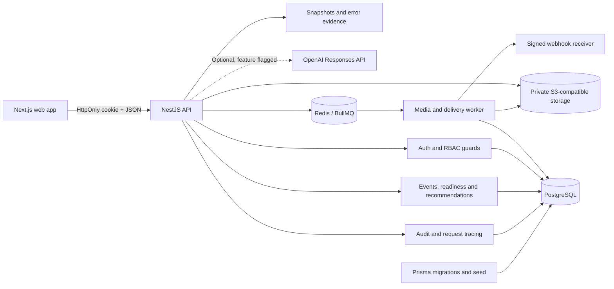

# OpsPilot

[](https://github.com/zhanru-dev/OpsPilot/actions/workflows/ci.yml)

OpsPilot is an English-first B2B operations platform for teams running complex online events. Its first vertical, **StreamOps**, turns fragmented event setup into an explainable launch-readiness workflow: accountable ownership, audience policy, critical runbooks, watch-page content, media state, recommendations and audit history in one control surface.

`v2.0.0` is the current release candidate. It extends the production-ready v1.5 platform with live-session control, public registration, scoped attendee identity, restricted access and live audience polling. The golden flow is database-backed, tenant-scoped, role-aware, asynchronous, measured, tested and documented.

## Product Thesis

> OpsPilot helps operations teams make complex online events launch-ready, execute them safely and leave an auditable record of every important decision.

The centrepiece is **Launch Control**. A versioned rules engine converts operational evidence into a score out of 100, distinguishes hard blockers from non-blocking gaps, and prevents invalid state transitions. Recommendations explain both the evidence and the suggested action.

## Platform Evidence

- Next.js 16, React 19, TypeScript and Tailwind CSS application.
- NestJS REST API with secure cookie sessions, token rotation and rate limiting.
- PostgreSQL and Prisma schema for users, workspaces, memberships, events and evidence.
- Workspace-scoped RBAC for operations managers and read-only analysts.
- Guarded `DRAFT -> CONFIGURING -> READY -> LIVE -> COMPLETED -> ARCHIVED` lifecycle.
- Event-scoped live operations room with durable updates and realtime refresh.
- Persistent event Chat for workspace staff and admitted attendees, with current-permission moderation, WebSocket delivery and missed-message recovery.
- Event Q&A with private review queues, replies, versioned edits, seven-pin moderation, audience settings and authenticated snapshot recovery.
- Draft, open and closed live polls with serialised lifecycle controls.
- Public registration with single-use email verification and scoped HttpOnly attendee sessions.
- Invitation-only and exact email-domain access with immediate session revocation.
- Pseudonymous attendee poll responses separated from workspace user identities.
- Archived-event immutability enforced by both the API and Launch Control.
- Versioned, deterministic readiness and recommendation engines.
- Optional grounded OpenAI recommendation provider behind a workspace feature flag.
- Strict structured output, evidence-key validation, persisted runs and explicit human confirmation.
- Deterministic fallback keeps the public demo complete without an API key.
- Editable event ownership and schedules, access policies, critical runbooks and watch-page content.
- Reversible ready-media attachment with readiness recalculation and audit evidence.
- Direct browser uploads through short-lived presigned URLs into private S3-compatible storage.
- ffprobe validation and FFmpeg video/audio derivatives in an independent BullMQ worker.
- Persisted processing jobs, progress, attempts, failure evidence and controlled retries.
- Short-lived private playback URLs, resumable multipart uploads and durable cancellation/deletion cleanup.
- Transactional domain-event outbox with signed `event.ready` and `event.started` webhooks.
- Bounded webhook retries, duplicate suppression, attempt history, manual recovery and trace IDs.
- Integration Centre for endpoint subscriptions, delivery health and retry evidence.
- Persisted daily operational analytics, date ranges and CSV export.
- Browser/API error fingerprints, trace evidence and manager resolution.
- Public recruiter-readable `/case-study` route with a real product screenshot.
- Actor-attributed audit history and request IDs.
- OpenAPI 3.1 contract and local Swagger UI.
- Unit, API integration, tenant-isolation, RBAC, session-rotation, media and browser golden-flow tests.
- Responsive mobile list views, accessible focus-trapped dialogs and server-side audit search.
- Automated WCAG checks plus desktop and mobile visual verification.
- Zero known production dependency vulnerabilities at release verification.

## Architecture



See [Architecture](docs/architecture.md), [Threat Model](docs/threat-model.md), [Reliability Runbook](docs/runbooks/v1.1-media-and-webhooks.md), [v1.2 Release Evidence](docs/v1.2-release.md), [Quality Report](docs/evidence/v1.2-quality-report.md), [Narrated Demo](docs/evidence/opspilot-v1.2-demo.mp4), [Portfolio Case Study](docs/case-study.md) and the authoritative [Product Strategy](docs/product-strategy.md).

## Stack

| Layer      | Technology                                                                           |
| ---------- | ------------------------------------------------------------------------------------ |
| Web        | Next.js 16, React 19, Tailwind CSS 4, TanStack Query, React Hook Form, Zod, Recharts |
| API        | NestJS 11, TypeScript, class-validator, secure cookies, JWT and Argon2               |
| Data       | PostgreSQL 17, Prisma 6, Redis 7 and private S3-compatible object storage            |
| Quality    | ESLint, Jest, Supertest, Playwright and axe-core                                     |
| Operations | BullMQ workers, FFmpeg/ffprobe, health metrics, OpenAPI 3.1 and Docker Compose       |

## Learning Guide

A Chinese study handbook with architecture and business-flow diagrams, a 23-lesson curriculum and a code-quality plan lives in [`docs/learning/`](docs/learning/README.md).

## Local Setup

Requirements: Node.js 22+, npm 10+ and Docker Desktop.

```powershell
Copy-Item .env.example .env
npm install
npm run services:up
npm run db:generate
npm run db:deploy
npm run db:seed
npm run dev
```

| Surface       | URL                                       |
| ------------- | ----------------------------------------- |
| Web app       | `http://localhost:3000`                   |
| REST API      | `http://localhost:4100/api/v1`            |
| Swagger UI    | `http://localhost:4100/docs`              |
| OpenAPI JSON  | `http://localhost:4100/docs/openapi.json` |
| MinIO console | `http://localhost:9001`                   |

The API uses `4100` by default and remains configurable through the environment.

### Object storage image

Local development and CI use an S3-compatible MinIO server. The upstream `minio/minio`
repository has been removed from Docker Hub, so the exact build verified by this project's
media test suites (`RELEASE.2025-09-07T16-13-09Z`, unmodified, AGPL-3.0) is mirrored at
`ghcr.io/zhanru-dev/minio`. This keeps test environments reproducible; that release no
longer receives upstream updates. It is a local/test dependency only: the application talks
to the S3 API through the AWS SDK, so a deployment should use managed S3 (or another
maintained S3-compatible service) configured through the `S3_*` variables.

## Chat and Topics integration: isolated local environment

The first Mudu integration slice adds Chat to existing StreamOps Live Operations and
the admitted attendee page. See the [foundation contract](docs/integration/mudu-integration-foundation.md)
and [migration report, verification and limitations](docs/integration/chat-migration-report.md).
Topics/Q&A is now integrated on the same surfaces. See its [migration report](docs/integration/topics-migration-report.md).
These commands describe the original Chat/Topics slice; the later streaming and media sections below cover their separate integrations.

From the repository root, use the separate services below to avoid the ordinary development database:

```sh
npm ci
docker compose -f docker-compose.chat-test.yml up -d --wait
node scripts/with-chat-test-env.mjs npm run db:generate
node scripts/with-chat-test-env.mjs npm run db:deploy
# First use of this disposable database ONLY. The existing seed replaces demo data.
node scripts/with-chat-test-env.mjs npm run db:seed
node scripts/with-chat-test-env.mjs npm run dev
```

On subsequent starts, run Compose, `db:generate`, `db:deploy` and `dev`; do not reseed. Secrets are
generated locally in ignored `.runtime/chat-test-secrets.json` with mode 0600. By default the wrapper
targets `opspilot_chat_test` on port 5546, Redis 6381 and isolated object storage 9002, with
Web/API on 3000/4100. Use `localhost` consistently for browser cookies.

### Running tests beside a developer environment

All disposable test addresses come from [`scripts/test-env.mjs`](scripts/test-env.mjs); the
wrappers, Compose files, Playwright configurations and specs read the same values. Override
them to run a second fully isolated stack while ordinary development servers keep running:

| Variable | Default | Purpose |
| --- | --- | --- |
| `OPSPILOT_TEST_WEB_PORT` / `OPSPILOT_TEST_API_PORT` | 3000 / 4100 | Test web and API processes |
| `OPSPILOT_TEST_POSTGRES_PORT` / `_CONTAINER` | 5546 / `opspilot-chat-test-postgres-1` | Disposable PostgreSQL |
| `OPSPILOT_TEST_REDIS_PORT`, `_BROADCAST_REDIS_PORT`, `_MEDIA_REDIS_PORT` | 6381, 6394, 6402 | Redis per suite |
| `OPSPILOT_TEST_MINIO_PORT`, `_SMTP_PORT`, `_MAILPIT_PORT` | 9002, 1026, 8025 | Object storage and mail |
| `OPSPILOT_TEST_RTMP_PORT`, `_HLS_PORT`, `_MEDIA_CONTROL_PORT` | 1937, 8890, 9999 | MediaMTX |
| `OPSPILOT_TEST_MEDIAMTX_CONTAINER` | `opspilot-broadcast-test-mediamtx-1` | MediaMTX container used by restart tests |

Use `COMPOSE_PROJECT_NAME=<name>` with `docker-compose.chat-test.yml` to create separately named
containers, and set the matching `*_CONTAINER` variables. Browser suites refuse any
`DATABASE_URL` that is not a `*_test` database and never reuse an already running server
unless `E2E_REUSE_SERVER=1` is set.

1. Sign in at `http://localhost:3000/login` with the seeded Alex account below.
2. Open **Product Operations Forum → Live Operations**, or
   `http://localhost:3000/streamops/events/33333333-3333-4333-8333-333333333335/live`.
3. In a separate browser profile/private window, open
   `http://localhost:3000/events/33333333-3333-4333-8333-333333333335/register`.
4. Register a local test email, open its message in Mailpit at `http://localhost:8025`,
   and open/confirm the verification link in that attendee window. Chat and Questions & answers appear after admission.
5. Send in either window, remove a message as Alex, and reload to verify persistence.
6. Submit an attendee question. Alex can open **Pending**, approve it, reply, pin/unpin,
   edit or delete it. **Question settings** controls audience publishing/replies/review.
   Other attendees see the question only after approval. Topics and Polls remain separate.

Topics tests are available as `test:topics:state`, `test:topics:api` and
`test:topics:browser`. Backend/browser tests require an isolated database ending `_test`,
with migrations and demo fixtures installed once. Stop local Web/API/worker processes before
browser suites. For production-web verification, run `npm run build` under the test environment,
then `E2E_PRODUCTION_WEB=1 npm run test:topics:browser` (or `test:ui` for all integration flows).
The [Topics report](docs/integration/topics-migration-report.md) records the exact isolated
environment and commands used during this integration.

Run Chat fault recovery tests with
`node scripts/with-chat-test-env.mjs npm run test:chat:recovery` after stopping the local
Web/API/worker processes. The suite starts its own isolated test API and browsers; it verifies
real database timeouts for both staff and attendees. See the
[reconnection repair report](docs/acceptance/opspilot-chat-reconnection-remediation.md)
for production-build mode, regression results and environment requirements.

For an existing populated OpsPilot database, use its normal configuration and apply only
`npm run db:generate` and `npm run db:deploy`. Do not reset or seed it for this migration.

## Production Images

The v1.5 release candidate packages each long-running process independently from the monorepo root:

```powershell
npm run containers:build
```

| Image                   | Process                             | Runtime probe               |
| ----------------------- | ----------------------------------- | --------------------------- |
| `opspilot-api:local`    | `node apps/api/dist/main.js`        | `/api/v1/health/ready`      |
| `opspilot-worker:local` | `node apps/api/dist/worker.js`      | Process and queue telemetry |
| `opspilot-web:local`    | Next.js standalone server on `PORT` | `/login`                    |

The API image includes the Prisma CLI so a deployment can run `npm run db:deploy` from the exact release image before accepting traffic. Demo seeding is never automatic: in production, `npm run db:seed` refuses to run unless that one command explicitly receives `DEMO_SEED_ALLOWED=true`.

The Web image requires `NEXT_PUBLIC_API_URL` as a build argument because browser-visible Next.js variables are compiled into the client bundle. The API accepts either `API_PORT` or a platform-provided `PORT`, validates all required dependencies at startup, and supports cross-site secure cookies through `COOKIE_SECURE=true` and `COOKIE_SAME_SITE=none`.

A complete deployment uses separate API, worker and Web services with managed PostgreSQL, Redis and private S3-compatible storage. The worker has no public port. Production storage must exist before startup, use `S3_AUTO_CREATE_BUCKET=false`, and set `S3_FORCE_PATH_STYLE` to match the provider.

## Demo Accounts

The login page has one email/password flow. Its demo account shortcuts only fill the form; every account authenticates through the same endpoint and receives the role assigned to it in the database.

| Role               | User        | Capability                                                              |
| ------------------ | ----------- | ----------------------------------------------------------------------- |
| Operations Manager | Alex Morgan | Configure events, resolve blockers and transition launch state          |
| Audience Analyst   | Maya Chen   | Inspect readiness, recommendations and audit evidence in read-only mode |

Direct credential login is also available for API testing:

- `alex.morgan@opspilot.demo` / `DemoPass123!`
- `maya.chen@opspilot.demo` / `DemoPass123!`

These accounts are seed data only and must not be used outside local or isolated demo environments.

## Quality Commands

```powershell
npm run lint
npm run typecheck
npm run test
npm run test:e2e
npm run test:ui
npm run build
npm audit --omit=dev
```

`test:ui` refuses to run against a database that is not `*_test`. CI provides one; locally run it
through the isolated wrapper, for example `node scripts/with-media-test-env.mjs env E2E_PRODUCTION_WEB=1 npm run test:ui`
after `npm run build` under the same wrapper.

The Playwright suite exercises the complete manager lifecycle through Archive, verifies analyst read-only boundaries, checks AI/analytics evidence, protects core pages from mobile overflow, and runs axe checks on key product surfaces.

## Readiness Model

| Criterion                  | Points | Hard blocker |
| -------------------------- | -----: | :----------: |
| Accountable owner          |     10 |     Yes      |
| Valid schedule             |     10 |     Yes      |
| Audience access policy     |     25 |     Yes      |
| Visible watch-page content |     15 |      No      |
| Ready media attached       |     15 |      No      |
| Critical runbook complete  |     25 |     Yes      |

Scores and evidence are calculated by the API. The UI does not decide whether a launch is allowed.

## Version Boundary

`v2.0.0` adds the live event and audience-engagement layer while preserving the v1.5 deployment boundary: independently deployable Web, API and worker processes; fail-fast production configuration; private media storage; and release smoke tests. This candidate is intentionally not deployed. A hosted release still requires the deployment gate against managed dependencies.

## Clean-Room Boundary

OpsPilot is an original implementation informed by general enterprise livestream operations and the author's prior domain experience. It does not reuse proprietary source code, assets, branding, private data, credentials, captured API routes or copied screen layouts from another product.

Research materials and implementation artefacts are kept separate. The codebase expresses original domain names, contracts, visual design and behaviour. See [ADR 0001](docs/adr/0001-clean-room-product-boundary.md).

## Repository Layout

```text
apps/
  api/                 NestJS API and tests
  web/                 Next.js product UI
docs/
  adr/                 Architecture decisions
  architecture.md      System and domain design
  case-study.md        Portfolio narrative and interview evidence
  evidence/            Measured AI and release-quality evidence
  product-strategy.md  Scope and release roadmap
  threat-model.md      Security assumptions and mitigations
e2e/                   Playwright golden flow
prisma/                Schema, migration and deterministic seed
```

## Integrated live broadcasting (local opt-in)

Live video uses the existing StreamEvent and admission flow. It has its own
BroadcastSession; ending video does not complete the event or close Chat, Topics
or Polls. Ordinary startup remains streaming-disabled.

For this existing integration workspace (preserves the current local database):

```sh
npm run broadcast:setup
npm run broadcast:dev
```

Stop the existing development process before starting another one on ports
3000/4100. Setup only deploys additive migrations; it never resets or reseeds the
existing database. For a fresh, disposable demonstration environment instead:

```sh
npm run broadcast:test:setup
node scripts/with-broadcast-env.mjs npm run dev
```

Open `http://localhost:3000`, sign in with a local demo account, open an event's
Live Operations, and prepare a broadcast. Expand **Publisher connection** and
generate a key. Use OBS with H.264/AAC, server `rtmp://127.0.0.1:1937/live`, and
the generated stream key. An attendee registers and verifies the existing email
link, then follows **Enter Watch Room** (`/events/<event-id>/watch`). Separate
browser profiles are independent participants. PUBLIC registration still requires
admission before protected video access.

Docker Desktop and FFmpeg (for automated stream fixtures) are required. Local
MediaMTX ports 1937/8890/9999 avoid the Mudu source environment. Development and
isolated broadcast tests share those ports and must run sequentially. Re-run the
appropriate setup when switching between their generated secrets.

```sh
npm run broadcast:test:setup
npm run build
npm run test:broadcast:migration
npm run test:broadcast:api
npm run test:broadcast:browser
```

These tests use `opspilot_broadcast_test`, separate Redis6394 and an isolated media
namespace. See the [migration report](docs/integration/live-streaming-migration-report.md)
for the contracts, measured recovery, fault tests, production limitations and
credential-safe FFmpeg example. No Live Streaming or Media Library assets are
copied from captured historical Mudu material.


## Integrated Media Library

Staff can upload multiple MP4/MOV/MP3/WAV/M4A files (100 MiB / 5 minutes), pause,
retry, cancel and resume after reload by reselecting the original file. Three
file workers transfer sequential 5 MiB parts. The existing BullMQ/FFmpeg pipeline
produces private previews and video thumbnails; READY means processing succeeded.
Unreferenced terminal assets may be deleted, with durable storage cleanup.
Existing ready assets are retained until explicit deletion.

Use the existing `npm run broadcast:setup` / `npm run broadcast:dev` environment
and open `/streamops/media`. Setup applies additive migrations without reseeding
existing development data. For disposable verification:

```sh
npm run media:test:setup
node scripts/with-media-test-env.mjs npm run build
npm run test:media:state
npm run test:media:api
npm run test:media:browser
```

See [Media integration, recovery contracts and evidence](docs/integration/media-library-migration-report.md).
Do not run test suites against shared data. Already issued private URLs retain
their documented TTL; new operations use current server-side permissions.
