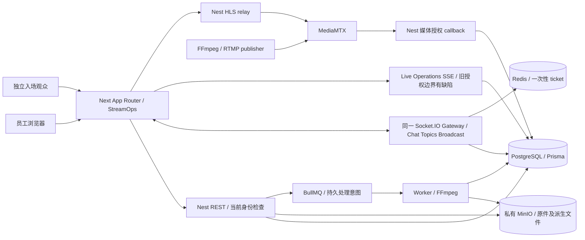

# OpsPilot 全系统独立工程验收报告

日期：2026-11-03（Europe/London）。任务依据：[更新后的验收任务](opspilot-final-system-acceptance-task.md)。本轮只验收；未修复应用、调整业务断言或开始新模块。

## A. 执行结论

**整体结论：FAIL。** 真实媒体、互动和同一活动的完整业务流程已运行成功，但原有管理接口与 SSE 没有贯彻当前会话/成员权限，存在两项实际复现的 P1。多数测试通过不能抵消权限边界失败。

| 判断 | 结果 | 原因 |
| --- | --- | --- |
| Portfolio Demo Ready | **NO** | 可展示主要正常流程，但尚不能可信地宣称统一撤权和安全隔离通过 |
| Local Engineering Acceptance | **NO** | SYS-AUTH-01、SYS-AUTH-02 阻断严格验收门槛 |
| Production Deployment Ready | **NO** | 已知权限缺陷；此外 HTTPS、公网部署、HA、备份恢复等仍 NOT VERIFIED |
| 数据完整性 | 本轮关键场景通过 | 真实 PostgreSQL/MinIO/BullMQ/FFmpeg 故障恢复、幂等、并发及哈希验证通过；不宣称跨系统原子事务 |
| 业务整合 | 主流程通过 | 同一 event 完成准备、入场、媒体、直播、Chat/Topics/Polls、中断恢复、结束、报表与归档 |
| 可靠性 | 有界验证通过，仍有 P2 | 直播刷新时序问题、CI 冷检出顺序和 readiness 超时问题尚存 |

缺陷总数：**P0 0、P1 2、P2 5、P3 1**。详见[缺陷登记](opspilot-final-defect-register.md)，执行顺序见[修复计划](opspilot-remediation-plan.md)。本轮没有证明生产凭证泄漏，也没有修改或轮换任何共享凭证。

## B. 基线、环境和证据边界

审核实现为 **`516f2a31242c615ab6858dc6472438aa38f13e00`**，主分支 **`feat/streamops-chat-integration`**；起始工作区干净。独立文档分支为 `audit/final-system-20261103`，首个文档检查点 `f31280c`。报告提交不是被审核应用的版本。

主仓库：`/Users/ruzhan/computer_science/projects/OpsPilot`。工作树及独立执行副本位于其 `.runtime/final-system-acceptance/20261103/{checkout,verify}`；依赖目录独立复制，未借用正在运行的普通开发 API。最终逐字节比较 **278 个应用、schema、migration、package/lock 文件，0 处变化**；执行副本的 22 个既有测试/脚本差异限于地址、镜像、实例标识和生产 Web 启动方式，完整补丁留存于证据目录。新增诊断脚本与报告分开存放，未改生产源码。

参考过 README、architecture/threat-model、Chat/Topics/Streaming/Media 集成与前次验收/修复报告。前次“已完成”仅用于定位，不作为本次 PASS。重点基线：Chat `cdd9242`；Broadcast `76ecbbd`/`53f0806`、修复 `2cd658b`/`ecbb7d4`；Media `ba91276`/`bda68de`、最近修复 `f40dbf6`/`80bda4d`，最终文档 `516f2a3`。前次媒体缺陷的真实回归本轮重新执行。

| 层 | 实际环境 |
| --- | --- |
| 主机 | macOS 26.6.2、x86_64、64 GiB RAM、16 logical CPU；普通开发服务同时存在 |
| Runtime | Node 22.20.0、npm 10.9.3、Docker Engine 29.2.1、Chrome 156.0.8078.74 |
| Web/API | 独占 localhost:3125 / :4225；生产 Next 构建；API 的集成/开发/编译产物和容器模式分别记录 |
| PostgreSQL | 独立容器 `opspilot-final-audit-20261103-postgres`，17.11，端口 5549；DB `opspilot_final_audit_20261103_test` |
| Redis | 独立容器同前缀 `-redis`，7.4.12，6407；与主 Compose 声明的 7.4.10 有版本差异 |
| MinIO | 独立容器同前缀 `-minio`，RELEASE.2025-09-07T16-13-09Z，9010；私有 bucket `opspilot-final-audit-20261103` |
| 邮件 | 独立 Mailpit v1.31.0，8028/1028；只处理本轮合成邮箱 |
| Streaming | 独立 MediaMTX v1.21.3，RTMP 1941、HLS 8898、control 9994；独立 callback 密钥 |
| FFmpeg | 宿主媒体 binary 6.1.1-tessus（ffmpeg-static package 5.3.0）；直播 publisher 9.0.1；Linux 容器另有真实处理验证 |
| 应用版本 | Next 16.4.3、React 19.2.4、Nest 11.2.8、Prisma 6.19.3、BullMQ 6.1.1、Socket.IO 4.8.3、TanStack Query 5.101.4、hls.js 1.7.3 |

凭证只在权限受限的本地环境文件内；不导出 cookie、JWT、S3 signature、推流密钥、认证 trace 或 `.Config.Env`。只对完全归本轮所有的进程/容器做 pause/restart/SIGKILL。普通开发环境 3000/4100、5546、6381、9002/9003、1026/8025、1937/8890/9999 不作为故障目标。迁移探针只删除它们自己创建的数据库；主测试卷和对象不销毁。

证据入口：[README](opspilot-final-system-evidence/README.md)、[命令时间线](opspilot-final-system-evidence/commands.jsonl)、[环境](opspilot-final-system-evidence/baseline-environment.json)、[源码比较](opspilot-final-system-evidence/source-comparison.json)。下文证据简称均指该目录及审核基线中的源码/测试。

## C. 架构清单

| 领域/边界 | 实际模型与所有权 | 主要代码 |
| --- | --- | --- |
| 工作空间/活动 | Workspace → StreamEvent；原有 Event owner、AccessPolicy、readiness/content/runbook 延续 | `prisma/schema.prisma`；`apps/api/src/events`、`readiness`、`access-policies`；Web `streamops` routes |
| 员工 | User、Session、WorkspaceMembership；cookie 登录，Argon2 密码；全局旧 guard 与新模块 authority 不一致 | `auth`、`common/guards`、`event-interactions/event-identity.service.ts`、`media/media-authority.ts` |
| 观众 | EventRegistration、AttendeeVerification、AttendeeSession；邮件验证、event cookie path、当前 admission；不加入 WorkspaceMembership | `attendee-access`、`event-registrations`；Web `events` routes |
| Chat | EventChatMessage + EventChatEvent；server-derived staff/attendee author，event sequence + durable journal + tombstone | `event-chat`、`features/chat`、`packages/chat-contracts` |
| Topics | EventTopic / EventTopicReply；独立于 Chat/Polls；event settings/revision，canonical entities + projections | `event-topics`、`features/topics`、`packages/topics-contracts` |
| Operations / Poll | LiveSession 为 operational session，LiveSessionUpdate、LivePoll/Option/Response；SSE 快照 | `live-sessions`、`live-polls`、原 Live Operations UI |
| Broadcast | BroadcastSession、BroadcastGrant；active session、publisher availability、viewer state 分开 | `broadcast`、`features/broadcast`、Watch Room、`packages/broadcast-contracts` |
| Media | MediaAsset 为 workspace 资产；EventMediaAsset 复用；初始化即保留 MediaAsset + MediaUpload；Part、ProcessingJob/Attempt、Variant | `media`、`infrastructure/storage`、`features/media`、`packages/media-contracts` |
| 后台/运营 | BullMQ、outbox/domain-event/webhook、analytics、audit、recommendations、可选 AI fallback | `worker.module.ts`、`domain-events`、`integrations`、`analytics` 等 |

没有发现另一个 Mudu Room/User/登录体系，未机械复制源项目 migrations。一个 Socket.IO 基础设施承载三个 interaction channel，SSE 保留原 operational 快照。没有必要重写框架或拆微服务。

明确的架构缺口是**授权强度不一致**：新模块在操作/发送边界查当前 Session 和 membership；旧全局 guard 把 JWT payload 当当前权限。模块各自通过，不等于整个产品统一权限通过。另一项证据充分的维护问题是主 architecture/threat-model 文档过时，详见 SYS-DOC-01。

## D. 要求追踪矩阵

状态含义：PASS 仅覆盖列出的条件和证据；FAIL 是实际违背要求；NOT VERIFIED 是缺少运行证据；NOT IMPLEMENTED 是实际没有该能力；DEFERRED 是已明确不在当前产品要求内。C 为严格关键门槛，B 为有界非关键范围。没有用“未发现”代替测试。

| ID | 级别/模块 | 预期及实际观察 | 代码 / 本轮证据 | 状态 |
| --- | --- | --- | --- | --- |
| A01 | C 基线 | 独立环境、源代码不变；278 文件相同，独占服务 | source-comparison、adaptations、cleanup | PASS |
| A02 | C Domain | StreamEvent 唯一活动身份、员工/观众分开、无 Room 复制 | schema、contracts、跨身份 API 测试 | PASS |
| B01 | C Auth | 正常登录、logout 清 cookie、refresh 可用；正常路径通过 | app API、registration browser | PASS |
| B02 | C 当前权限 | 降权/移除成员/logout 应拒绝旧凭证；旧 REST 仍 200/201 | auth.guard、roles.guard；security-results | **FAIL** |
| B03 | C Event | 创建编辑、owner/readiness、状态转换、归档不可变 | app API、launch-control、journey | PASS |
| B04 | C Admission | 公开/邀请受限入场、单次验证、过期撤销、重入和隔离 | attendee-access/restricted API + browser | PASS |
| B05 | C Operations | 操作更新、正常 SSE、Polls、analytics/audit 页面 | app API、launch-control、journey | PASS |
| B06 | C SSE 权限 | 撤权/过期连接不得再收到新私有数据；实际仍收到 | live-sessions.service；security-results | **FAIL** |
| B07 | B Refresh | 每次轮换消费旧值；同秒值相同且重放成功 | auth.service；security-results | **FAIL** |
| C01 | C Chat | 双身份 WS、PG 保存、reload、分页、server author | chat API 12 项、browser 2 项 | PASS |
| C02 | C Chat 一致性 | lost ack/重试/丢通知/删除/重排不重复或复活 | durable journal、chat-state、真实 API/browser | PASS |
| C03 | C Chat 恢复 | 首次连接及重连超时、旧 503、WS 中断后恢复 | chat-recovery 12 项；PG/Redis 实例故障 | PASS |
| C04 | C Chat UI | 老历史锚点、不强滚、unread/jump、DOM 有界 | browser 430 missed +450 burst，300 rows | PASS |
| C05 | C Chat 安全 | 当前 session/member、ticket、event/identity 切换 | chat API、browser、security-results | PASS |
| D01 | C Topics | 提交/审核/回复/编辑/置顶/删除/settings 保存 | topics API 14 项、browser 11 项 | PASS |
| D02 | C Topics 隐私 | pending body/id/count 仅作者/授权员工；直接 API 无绕过 | topics service/authorization；API +browser | PASS |
| D03 | C Topics 并发 | 七 pin、同一 approve、approve/delete、reply/delete 保持不变量 | PG 约束/行锁；API +topic-race-results 14 观测 | PASS |
| D04 | C Topics 状态 | 延迟快照/丢回执/429/删除/切身份不复活或漏私有内容 | canonical state；state/API/browser | PASS |
| E01 | C 身份隔离 | 观众不变员工、客户端不能伪造 author、外 workspace/event 拒绝 | identity +Chat/Topics/Broadcast/Media API | PASS |
| E02 | C WS | 一次性 ticket、Origin、事件订阅、撤权、清理 | Gateway/ticket；API +recovery +browser | PASS |
| E03 | C 统一权限 | 所有原有和新模块使用当前权限；原 REST/SSE 例外 | SYS-AUTH-01/02 | **FAIL** |
| E04 | C 媒体边界 | 新 part/preview/complete/cancel 请求须当前身份；private bucket | media-boundaries/multipart；MinIO 直接请求 | PASS |
| E05 | C 直播边界 | RTMP、HLS master/variant/init/segment、control 独立授权 | broadcast API 8 项、真实 publisher/browser | PASS |
| E06 | C UGC/泄漏 | HTML 文本安全、Origin 拒绝、凭证不进日志/client bundle | chat/topics browser、security/hygiene | PASS（有界扫描） |
| F01 | C Upload | 真实分片/边界/校验/限制/确认进度与持久化 | multipart API、browser、100 MiB probe | PASS |
| F02 | C Queue | 三 file workers、第四排队、slot 提前保留/取消释放；每 file 顺序 part | media queue/state +受控真实 browser | PASS |
| F03 | C Resume | reload/reselect 验身份，只传缺 part；取消/失败重试语义 | multipart browser、API、SHA-256 | PASS |
| F04 | C Finalize | 丢回执/重复/取消竞争产生一个 asset/job 或取消终态 | multipart API/browser、restart | PASS |
| F05 | C Processing | 实际 BullMQ/FFmpeg/thumbnail/preview、失败重试/去重 | processing 6 项、restart、Linux containers | PASS |
| F06 | C Recovery | PG/MinIO/queue 边界具备 durable intent/fence/cleanup | 下节 R01–R09、remediation 10 项 | PASS |
| F07 | C 历史媒体修复 | 旧 URL 不能改 canonical source；旧 worker/late PUT 不回写 | remediation/live-fence、container-media | PASS |
| F08 | C Preview | 原件哈希、真实解码、切换/关闭释放、10 次资源循环 | media browser/performance | PASS |
| G01 | C 实时媒体 | 真 RTMP→HLS→browser advancing frames；AAC 真解码 | broadcast browser、journey、live-audio-results | PASS |
| G02 | C 生命周期 | 单 active、并发、幂等、replacement selection、结束/控制拒绝恢复 | broadcast API/browser/container | PASS |
| G03 | C 恢复 | publisher/API/MediaMTX 断开恢复；拒绝未授权重发 | broadcast measurement、journey | PASS |
| G04 | C Player | play/pause/mute/fullscreen、autoplay/error/retry/unmount | broadcast browser、journey；部分拒绝通过故障注入 | PASS |
| G05 | B Retry UX | refresh 期间应等待新 revision；实际可再次旧值 409 | controlled-race、首次 browser failure | **FAIL** |
| H01 | C 同一活动流程 | 同一 event/asset/broadcast 连续走通；双观众真实入场 | journey-results +独立新 E2E | PASS |
| H02 | C 模块独立性 | 视频/媒体失败不重置 Chat/Topics/Polls | journey：失败媒体及 publisher outage | PASS |
| I01 | C 有界故障 | 自有 PG/Redis/MinIO/worker/API/MTX 恢复且数据保留 | infrastructure 19 观测、restart/browser | PASS |
| I02 | B Ready | 依赖不响应应及时非 ready；Redis 暂停6秒无响应 | infrastructure.readinessOutage | **FAIL** |
| J01 | C 本地响应 | 有界 Chat/upload/preview 负载，未见无界 DOM/slot 堵塞 | 性能表及原始 JSON | PASS |
| J02 | B 容量/长期泄漏 | 生产并发、长时 native/GPU heap、全面 N+1 profile | 只测本地有限样本 | NOT VERIFIED |
| K01 | C Migration | 空库16 migrations、pre-Chat旧数据到最终及局部升级保留 | 三 migration probes +db-deploy | PASS |
| K02 | C Constraints | author形状、同eventFK、idempotency、pin/active/parts约束 | migrations、真实 PG 否定测试 | PASS |
| L01 | C Quality | lint/typecheck/unit/state、API+Web production build | 对应本轮命令均成功 | PASS |
| L02 | C Runtime | 三镜像 build/start/health、真实处理/stream；Compose config | docker-*、container-* | PASS（本地模式） |
| L03 | B CI | 冷检出应自动构建必要 dist；现有 workflow 顺序失败 | ci-order-results | **FAIL** |
| L04 | B Dependencies | 生产审计0；dev链40受影响节点尚存 | official audit、production audit | **FAIL（开发依赖）** |
| L05 | B 部署 | 公网TLS、HA、backup/restore、Redis7.4.10精确运行 | 没有相应部署证据 | NOT VERIFIED |
| M01 | C 核心证据 | 真实服务与 mocks 分开；保留初次失败及诊断 | 命令记录/测试质量评估 | PASS |
| N01 | B 文档 | 当前主入口应与实际身份/媒体契约一致；旧文档滞后 | architecture/threat-model vs源码 | **FAIL** |
| X01 | — 扩展范围 | 完整权限管理/注册账号 UI、录制回放/CDN/ABR、Topics附件迁移 | 未作为本轮需求 | DEFERRED |
| X02 | — Workspace UI | 本轮选择 seeded workspace；未实现通用 self-service workspace 创建流程 | 当前路由及 seed | NOT IMPLEMENTED（非门槛） |

## E. 各模块验收与原功能回归

| 模块 | 判定 | 说明 |
| --- | --- | --- |
| Chat | **PASS（本轮本地范围）** | 12 API、2主浏览器、12恢复场景及完整 journey；角色撤销和跨活动直接请求通过 |
| Topics / Q&A | **PASS（本轮本地范围）** | 14 API、11浏览器、独立14并发观测；真实七 pin、eligible parent、pending 隐私与过时状态通过 |
| Permission Management | **FAIL** | 是共享身份/权限契约验收，不是声称搬迁完整后台；原 REST 与 SSE 两项 P1 |
| Media Library | **PASS（支持范围）** | 真实分片/续传/取消/校验/processing/cleanup/fence/restart；100 MiB 上限、3 file workers |
| Live Streaming | **CONDITIONAL PASS（模块）** | 实际 RTMP/HLS/AAC及恢复通过；SYS-BCAST-01 为可恢复 P2，不代表系统整体可有条件通过 |
| Watch Room | 功能 **PASS** | 同一活动真实多用户流程通过；系统授权总门槛仍 FAIL |
| Polls | 功能 **PASS**，权限回归 **FAIL** | 员工/观众投票、并发/结束均通过；旧 JWT 降权后还可创建 Poll |
| 原 OpsPilot | 正常功能回归 **PASS**，安全验收 **FAIL** | Event/Launch/admission/analytics/read-only UI 等通过；新增撤权/过期连接测试发现旧缺陷 |
| 共享基础设施 | 本地运行 **PASS**，运维存在 P2 | migrations/容器/依赖恢复通过；冷 CI、readiness、开发依赖有问题 |

原有 `app.e2e` 19 项包括 health/受保护资源、Origin、webhook demo delivery/retry、refresh/logout路径、event owner/workspace、read-only role、recommendation reconciliation、AI fallback/evaluation、analytics/triage、media attach/detach、LiveSession、Poll、registration/redaction、archive。另有受限/公开入场专用 API 和两项真实邮件浏览器流程。不能把正常角色测试的通过解释为“动态权限也通过”；本轮独立攻击性回归明确反证了后者。

## F. 一个连续的真实业务旅程

独立新增 `final-audit-journey.spec.ts` 没有把多个旧 suite 拼在一起。主 Event 为 `ed875b5f-c415-4965-993b-8fa00911fa1d`；主资产 `cf52a6e7-80d1-4dd1-a9e0-2b430d368c6f`。选用隔离 seed 的 workspace/员工后，以下动作通过实际产品 UI/API 执行；没有以 SQL 修改主事件生命周期来跳过 readiness。

| 累计耗时 | 完成步骤和断言 |
| --- | --- |
| 0.8–1.9s | 真实密码登录、UI 创建活动、配置公开入场及 Launch preparation |
| 3.5–4.3s | 新视频222943 bytes上传；MinIO SHA-256 `ccadaea6ab9004f12bf4d453dfe015750454839207c841acfab2919cfee908f4`；真实worker产出PREVIEW/THUMBNAIL并READY；同一资产attach、readiness100、READY→LIVE |
| 15.8s | 两个独立 browser context，通过实际 Mailpit 邮件确认合法入场 |
| 24.1s | 授权 FFmpeg RTMP publisher，两个 HLS decoder 有 advancing time/frames；本次 startup6922ms |
| 31.2s | 观众发 Chat、员工 moderation、私有pending Topic→approval→reply→pin，发布并投 Poll |
| 39.3–40.2s | 额外故意损坏的媒体进入FAILED而主Chat/HLS继续；fullscreen进出；禁用audience发布，直接API403后恢复设置 |
| 53.0s | 停 publisher 后新Chat、新Topic审批和第二次投票仍工作；恢复publisher后实际视频恢复，6908ms |
| 55.9–56.1s | 观众reload保留互动；结束Broadcast但event仍LIVE；写operations、Complete event、refresh analytics，PG验证两个session终态，UI归档 |

整个用例56.7s，命令含服务启动66.944s。作用域、私有 pending、数据持久化和最后 lifecycle 都有实际断言。该流程里的权限变更是 Topics audience setting，不冒充已发现失败的“员工撤权”已通过；员工撤权在独立 security probe 中判 FAIL。

## G. 安全评估

### 两个阻断问题

**SYS-AUTH-01：原 REST 信任过期角色快照。** 当前 manager 降为 VIEWER 后，原cookie修改event200、创建poll201、写live-update201；删除membership后workspace/events/live-session均200；logout204后重放accesscookie仍可workspace200。新模块 Chat/Topics/Broadcast/Media 同样移除成员后403；fresh viewer token编辑403。根因是 `AuthGuard` 只验JWT，`RolesGuard` 读claim；当前session/member没有在原管理边界统一复核。

**SYS-AUTH-02：已连接 SSE 在撤权/过期后泄露新内容。** membership移除后，另一有效管理员新写的随机marker继续送达旧连接。另用同一已验证管理员的2秒测试JWT：新的REST401，但旧SSE继续收到后来写的数据。每3秒轮询持有原用户payload，没有再授权。

这些文件与融合前 `0e005c193769d67a945e98229a1f2707163d8f52` 的相关 guard/service 相同，属于原有缺陷和全系统集成遗漏，不误报为最新Media变更引入。会话撤销后的旧cookie重放是直接API威胁模型；正常浏览器清cookie不修复服务端问题。

### 已通过的边界及限制

- 新模块使用 server-derived staff/attendee principal。观众session的event限制、staff cookie不代替入场、跨workspace/event、失效Session、author spoof均有真实否定测试。
- Chat ticket 是短时Redis一次性票据；错误Origin、过期、重复消费、撤销session后的issued ticket拒绝；现有WS有当前权限和订阅复核，浏览器切身份清缓存。
- Topics pending内容、ID和计数不对其他观众公开；设置改变在后端执行；并发变更使用当前授权/版本边界。UGC HTML按文本显示，实际测试未插入script/img节点。
- MinIO bucket私有；part grants最长60s，preview签名短时有效；授权前复核当前成员。已签出的URL允许在TTL内使用是明确bearer契约，撤权后不再发新grant；不宣称能撤回已下载字节。
- RTMP callback和HLS各层实际拒绝未授权访问；control不是普通观众接口。publishing key撤销、过期观众、API不可用时publisher拒绝、HLS renewals和control refusal测试通过。
- Broadcast active选择不依赖旧结束session的高revision，真实替代session/cleanup失败场景通过。最近会话选择P1与密钥日志历史 concern，在OpsPilot对应实现及运行样本中未重现。
- 配置单测覆盖生产secret/secure-cookie/HTTPS条件；Origin跨站写请求实际403。没有做公网攻击、真实第三方账户操作或完整渗透测试。
- hygiene检查已知本轮生成秘密及credential-query模式、源码、client bundles、runtime/MediaMTX logs、persisted ErrorReport，结果无匹配。仅证明已知值/模式的本轮样本；不证明Git历史和所有未知秘密绝对不存在。没有捕获到需轮换的真实生产凭证。

安全探针24项中10项FAIL分布于上述2个P1和refresh P2；脚本退出0只是“采集完成”，不是安全PASS。全部期望/实际HTTP结果见 `security-results.json`。

## H. PostgreSQL、存储与恢复

事务职责明确：PostgreSQL保存业务真相和durable intent，MinIO/Redis可能先成功或后失败，由幂等标识、状态条件和reconciliation恢复。不是声称Prisma事务包含对象存储。

| ID | 实际故障边界 | 观测结果 / 恢复策略 | 证据 |
| --- | --- | --- | --- |
| R01 | multipart object完成后DB提交失败 | 同一upload恢复object receipt，一份asset/processing intent；哈希不变 | multipart API |
| R02 | DB存在原件丢失/孤立派生object | 检测丢失original、失败状态/清理orphan；保留已注册有效object | boundaries API |
| R03 | completion成功但响应丢失 | 浏览器查询/重试原operation，唯一asset/job | multipart browser/API |
| R04 | DB注册处理意图后enqueue失败 | durable job保留，recovery重新排同一job | multipart API |
| R05 | 转码产物存在但最终DB失败 | 同代安全重试/孤立产物清理，唯一variants，不提前重复publish | processing API |
| R06 | storage delete成功、cleanup DB回滚 | 保留cleanup intent，幂等再删、再次提交 | boundaries API |
| R07 | tombstone提交、storage失败或late PUT | 重复cleanup恢复；真实PUT在grant到期前开始、首轮cleanup后完成仍被收集 | multipart/remediation API |
| R08 | worker被SIGKILL或旧worker仍存活 | generation fencing阻止旧PG/Redis进度/variant/event回写；新worker恢复 | restart 1项、remediation参数化3项 |
| R09 | API在object完成后SIGKILL | compiled child重启，原upload恢复；最终一个asset/job/event和相同原件 | restart、container-media |
| R10 | cancellation与finalization并发 | 串行化终态，不把已取消upload发布；允许先完成者的明确结果 | multipart API |
| R11 | legacy可写staging URL被重放 | canonical冻结对象、ETag/条件copy及持久snapshot避免替换；旧ownerless intent兼容 | remediation +Linux container |
| R12 | 队列recovery遇100个健康delayed和一个失败项 | keyset继续，不永远饿死后续intent；业务timestamp不被扫描改写 | remediation API |
| R13 | 自有PG pause/restart | 请求有界客户端超时；恢复后服务可用、message持久、同operation仍一行 | infrastructure-results |
| R14 | 自有Redis pause/restart | ticket请求受阻，恢复可取新票；不能误报失效身份；ready无deadline另记P2 | infrastructure-results |
| R15 | 自有MinIO pause/restart | actual part中断，同part retry/confirm/complete成功；READY、SHA256及两派生物持久 | infrastructure-results |
| R16 | MediaMTX/API/publisher中断 | HLS失败状态、自动重连/重新grant、真实解码恢复；不改Chat/Topics/Polls状态 | broadcast browser、journey |

本轮未观测到上述场景留下永久卡死或重复canonical记录。清理是有界重试的最终一致性，不是删除请求完成瞬间保证磁盘零对象；被合法TTL授权且已在途请求可能晚完成，tombstone扫描承担后续回收。

迁移检查：空库16条全部成功；Broadcast升级40个旧表/5行夹具不变；Media升级44个旧表/9行夹具不变；独立pre-Chat→最终升级36个旧表/5行夹具、旧列digest不变，新revision默认0。代表性小数据验证不能证明任意历史脏数据或TB级在线迁移无锁等待。

Chat复合FK约束event、sender形状、唯一operation和sequence；Topics pinSlot唯一及1..7/approved/not-deleted CHECK加event事务锁，parent关系同event；Broadcast一个ACTIVE的partial unique；Media part bounds/checksum及upload/processing唯一键都有源码和真实PG约束失败测试。没有发现必须复制新Room或重建旧schema的理由。

## I. 性能及资源观测

这是共享开发主机上的有限本地测量，没有生产容量、P99 SLA或优化前后对比。时间来自测试monotonic计时；CDP仅V8/DOM，不含GPU、native decoder和全部Blob内存。

| 工作负载/方法 | 实测 | 解释与边界 |
| --- | --- | --- |
| Chat：120历史+430 missed journal commits，真实REST/WS恢复 | replay1446ms；旧anchor偏差<3px | journal数据夹具不等于430真实用户并发发送 |
| Chat：450条live burst | delivery3646ms；DOM300rows；composer可响应 | bounded window有效；非长期聊天室容量 |
| Chat PG：rollback夹具5000行，before2500取50，EXPLAIN ANALYZE | backward sequence index scan，execution0.047ms、planning0.664ms、5sharedhitblocks | 单次warm查询，不是端到端延迟 |
| Topics：45行、2页 | 310ms | 小规模分页一致性观测 |
| Media：104856576 bytes、20parts、1 active file、3 configured workers | upload4909ms、READY6832ms、partwindow2585ms/38.684MiB/s、processing1522ms | 4秒640×360 H264视频加MP4 padding，不是100MiB复杂视频转码成本 |
| 上传期间27采样 | API RSS265396224–354136064B；browserheap8577432–15416704B；framegapP95 16.7ms/max16.8ms | API RSS不含worker/MinIO；局部短测量 |
| progress rendering | 20DOM变化，4.074/s | 是DOM mutation，不冒充React render次数 |
| Preview10次开关+GC | retainedvideo0；稳定阶段listeners384、nodes1635；heap约8.26→8.54MB | 无持续节点累积；小幅heap增长与native泄漏仍需长时对照 |
| Streaming640×360 H264/AAC24fps800kbps、2viewers+staff | startup6925ms；publisher识别3329/1312ms；恢复5907/7921ms | 本地MediaMTX/HLS延迟，非低延迟协议保证 |
| MediaMTX/API重启 | 恢复7918/2880ms；grant renewals10/8，无429 | 故障期预期503/403出现；不统计成正常路径无错误 |
| Player3次teardown | outstanding grants [2,2,2]；卸载后无新HLS请求 | 初末CDP屏幕不同，不能把heap下降说成优化 |
| 独立直播AAC音频 | AudioContext running、48000Hz、最大RMS0.08967、video84frames | 真440Hz→AAC→RTMP→HLS→browser；输出gain0避免扬声器打扰，不是play()mock |
| 重启测试子进程40个一秒采样 | 两个forked Node子进程峰值约153012/145692KiB，CPU10.1%/27.6% | 只归属被采样PID，非独立完整FFmpeg峰值/全机资源；首次旅程采样为空，未使用 |

可确认的瓶颈/风险是 readiness等待不设deadline、原SSE每连接3秒重新组装快照和统一授权缺口。未对所有服务做全面SQL tracing，不能声称“N+1不存在”。现有行锁对单event moderation串行化是正确性取舍；只有真实更大负载数据才支持改并发结构。此时没有证据要求引入全局状态库、微服务或更换媒体服务器。

## J. 实际命令与测试结果

命令在独立 `verify` 目录、注入私有审计环境后执行。包装器为 `node ../run.mjs <label> <command> <args...>`；`commands.jsonl` 保留精确参数、UTC时间、exit和耗时。下表是包装器实际运行的子命令，不可直接拿共享DB运行reset/故障探针。

| 命令 | 本轮结果 |
| --- | --- |
| `npm run db:deploy` / `npm run db:seed` | 成功；16 migrations；只在独立库seed |
| `npm run lint` | 成功，29.5s |
| `npm run typecheck` | 成功，17.4s |
| `npm run build` | API + production Next成功，33.0s |
| `npm test -- --runInBand` | **16 suites /106 tests passed** |
| `node --import tsx --test tests/chat-state.test.ts tests/topics-state.test.ts tests/topics-drafts.test.ts tests/media-queue.test.ts` | **19 passed**；纯state/unit，不计真实网络 |
| `npm run test:e2e --workspace=@opspilot/api -- --runInBand`（BROADCAST_ENABLED=true） | **10 suites通过、1失败；101 passed /1 failed**；8直播测试确实运行 |
| `npm run test:e2e --workspace=@opspilot/api -- --runInBand media-restart.e2e-spec` | 编译产物稳定后 **1 passed**，66.7s测试；最终102个不同API用例均有通过证据，非单次102全绿 |
| `npx playwright test e2e/chat.spec.ts e2e/topics.spec.ts e2e/launch-control.spec.ts e2e/registration.spec.ts e2e/restricted-registration.spec.ts e2e/media-processing.spec.ts e2e/media-multipart.spec.ts e2e/media-performance.spec.ts` | **27 passed**，452s；真实API/PG/MinIO/worker/邮件及生产Web |
| `npx playwright test --config=playwright.chat-recovery.config.ts` | **12 passed**，82.9s；员工与观众对称故障恢复 |
| `npx playwright test --config=playwright.ui.config.ts` | **12 passed**，17.0s；mock API UI测试，单列 |
| `npx playwright test --config=playwright.broadcast.config.ts` | 初次 **3 passed /1 failed**；真实直播主路径通过，End retry409失败 |
| 同上加 `--grep 'lost start/end' --repeat-each=3` | 原断言 **3次通过**；不消除时序缺陷 |
| `npx playwright test --config=playwright.broadcast-race.config.ts` | **1 diagnostic completed**；可控延迟复现409并确认刷新后201 |
| `npx playwright test --config=playwright.journey.config.ts` | 修正审计夹具后 **1 passed**；完整同活动旅程 |
| `npx playwright test --config=playwright.audio.config.ts` | **1 passed**，25.1s；真实直播AAC浏览器解码 |
| `node audit-security.cjs` | 24观测/10FAIL；采集完成，不能记安全PASS |
| `node audit-topic-races.cjs` | 14并发/一致性观测PASS |
| `node audit-infrastructure.cjs` | 19恢复/完整性观测PASS；另发现readiness6s无响应 |
| `node audit-query-plans.cjs` | 真实PG explain完成，夹具事务回滚 |
| `node scripts/check-broadcast-migration.mjs` / `check-media-migration.mjs` / `audit-full-migration.mjs` | 3种迁移兼容检查成功 |
| `node scripts/audit-ci-order.mjs` | 诊断完成；无dist时原integration **1 failed**，MODULE_NOT_FOUND；生成目录finally恢复 |
| `docker compose config --quiet` | 成功 |
| `docker build --target api -f apps/api/Dockerfile -t opspilot-final-audit-api:20261103 .` | 成功 |
| `docker build --target worker -f apps/api/Dockerfile -t opspilot-final-audit-worker:20261103 .` | 成功 |
| `docker build --build-arg NEXT_PUBLIC_API_URL=http://localhost:4225/api/v1 -f apps/web/Dockerfile -t opspilot-final-audit-web:20261103 .` | 成功 |
| `node scripts/check-media-containers.mjs` / `check-broadcast-containers.mjs` | 两项成功；实际Linux容器API/worker/Web及媒体/直播，运行配置NODE_ENV=test |
| `npm audit --json` | 默认registry404 NOT_IMPLEMENTED，失败如实保留 |
| `npm audit --json --registry=https://registry.npmjs.org` | 36moderate/4low/0high/0critical，exit1 |
| `npm audit --omit=dev --json --registry=https://registry.npmjs.org` | **0漏洞**，exit0 |
| `node audit-hygiene.cjs` | 已知秘密和credential模式扫描无匹配；结果范围单列，不是完整渗透证明 |

### 首次失败、复测与测试质量

1. API总回归的restart child失败发生于审计一度并行启动dev API watch、清理/重建同一执行副本dist。发现后停止重叠运行；保留原101/1结果，稳定compiled产物和独占worker后原测试通过。它不能解释掉另一个真实CI问题：冷检出无dist时原workflow顺序确定失败，已单独复现。
2. 第一轮常规browser启动被审计主动中止（exit130）以消除上述冲突，没有把未完成用例计PASS。独占重跑27项全部通过。
3. security probe最初用错夹具AccessPolicy字段；full-chain migration最初用错EventMediaAsset单独id（实际为复合键），两次夹具失败；journey第一次未重新展开因revision重挂载的settings表单而中止，第二次末尾查询误用`broadcastSessions`字段而失败。只修审计脚本/locator，最终使用实际`broadcasts`和支持UI重跑通过；应用源码未变化。
4. Broadcast首次End409是应用时序缺陷，3次原测试复测成功后仍以可控GET延迟稳定复现，登记P2。没有通过加重试或降低期望状态码来制造全绿。
5. 模型状态测试、12项UI mocks、正常HTTP成功、真正PG/WS/S3/FFmpeg/媒体decode和诊断性脚本，分别计数。不会将“probe运行成功”或重复的3次测试加入唯一通过总数。
6. 本轮完整API启用了直播，不存在8项直播被跳过后冒称通过；原CI默认会skip直播的配置缺口单独记录。未执行远端GitHub Actions、deployment.config外部站点套件、真实第三方AI/provider或生产基础设施测试。
7. 已有测试擅长当前新模块权限和恢复，对原全局REST/SSE撤权覆盖不足；仅检查logout cookie删除、refresh返回user不验证旧凭证失效，是本次P1/P2逃过历史套件的直接覆盖缺口。

## K. 限制、运维与最终门槛

未验证范围：公网HTTPS/cookie/domain代理组合、生产网络策略/RTMP端口、云S3差异、水平扩展/跨节点WS、灾备和备份还原、长期native/GPU泄漏、Safari/Firefox/iOS、OBS硬件组合、无限时长依赖故障、全部历史脏数据升级、全面query tracing和生产并发容量。精确Compose Redis7.4.10镜像未运行，本轮为7.4.12；Compose配置成功不等于完整生产Compose部署验证。配置中的本地默认凭证/部分广域bind不适合直接公网暴露。

边界条件：Chat有300行窗口及bounded replay/cache；Topics有回复上限和分页；Media100MiB、20parts/5MiB、3fileworkers、owner active quota12；HLS存在秒级启动/恢复与短时grant；草稿未承诺整页刷新保存。录制/CDN/ABR、完整帐号注册/权限管理产品、Topics附件整套迁移不在本轮门槛内。

实际部署验证缺口不会被误标已实现功能的P1，但目前两个已复现的P1已经足够阻断严格PASS。没有发现本轮可证实的P0、跨系统永久数据破坏或秘密实际外泄。也不能因此把统一安全结论改成PASS。

本轮结束只停止审计自己创建的服务，保留专用卷、夹具和安全证据；停止后原开发Web登录页和API readiness均返回200，继续可用。最终服务检查记录在 `cleanup-results.json`。报告/证据提交限定于 `docs/acceptance`；原应用和测试基线不变。

**最终决定：FAIL。Portfolio Demo Ready: NO；Local Engineering Acceptance: NO；Production Deployment Ready: NO。** 先修当前权限和已打开SSE的授权，再修refresh、Broadcast刷新时序、CI/ready，按[计划](opspilot-remediation-plan.md)重新验收。本轮到此停止，不执行修复。
