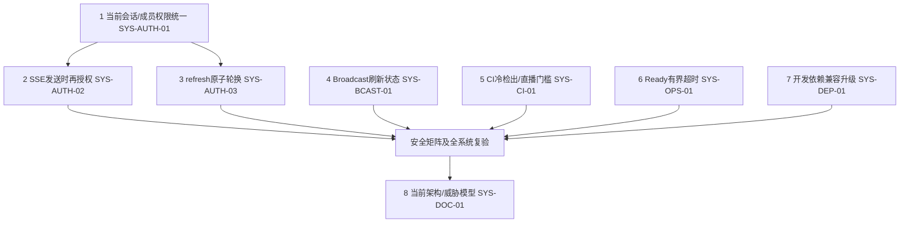

# OpsPilot 全系统验收修复计划

日期：2026-11-03。审核版本 `516f2a31242c615ab6858dc6472438aa38f13e00`，分支 `feat/streamops-chat-integration`。关联：[总报告](opspilot-final-system-acceptance.md)、[缺陷登记](opspilot-final-defect-register.md)。

**本文件是后续建议，没有实施任何修复。** 当前 FAIL，P0 0 / P1 2 / P2 5 / P3 1。修复应沿现有 OpsPilot 身份和领域边界完成，不重写 Chat/Topics/Polls，不增加登录系统，不扩展新模块。

## 1. 优先顺序与依赖

建议按下列小检查点提交，每项附失败→修复→通过的实际证据，不把原验收报告改写成从未失败。实施前记录新基线，保留所有不相关未提交内容，只用专用数据库/对象存储；不重置共享数据。

## 2. 阻断项：先统一当前授权

### 检查点 1 — SYS-AUTH-01 / P1

目标：在原有受保护 REST 边界检查当前 Session 有效性、User、WorkspaceMembership 及当前 role；JWT 用于确认签名身份和 session 指向，不能把曾经的 role/workspace claim 当长期权限。

建议范围：`auth/auth.guard.ts`、`auth.service.ts`、`common/guards/roles.guard.ts` 与已存在的 event identity/media authority 协调。提取或复用最小身份读取能力，不增加平行 RBAC。保留 event/workspace 资源所有权过滤及需要抵抗并发撤权的事务锁。不要让 attendee cookie 变成员工身份；public admission、health、media callback 的特殊入口仍按各自契约处理。

可复验完成条件：

- 原 security probe 的降权 event PATCH、Poll POST、live-update POST 均拒绝；fresh viewer 行为一致。
- 删除membership、logout、Session过期/撤销后，保留旧accesscookie请求 workspace/events/Live Operations 失败；无workspace数据泄漏。
- 逐项覆盖 policy/content/runbook/registration/invitation/media/analytics/integrations/audit 等原有管理路由，区分允许读取和管理能力。
- 两个workspace、两个event、员工/观众/匿名分别验证；新增授权查询失败应fail closed且有可理解的暂时错误，不能退回JWT role。
- Chat/Topics/Broadcast/Media已通过的当前权限及跨域测试继续通过；normal login/logout/refresh和原工作流不退化。

应明确 session 的15分钟access有效期与撤销后的服务端处理，不能只缩短JWT TTL或隐藏UI。性能检查只针对新增查询的实际负载，避免先引入无法即时撤销的权限缓存。

### 检查点 2 — SYS-AUTH-02 / P1

目标：现有 SSE 已建立连接也要受当前身份限制。仅升级连接初始 AuthGuard 不够。

建议范围：`live-sessions/live-sessions.service.ts`、controller及共用身份读取。每次受保护snapshot生成/发送时检查session/member/event权限；定义授权有效期、失败/撤权关闭语义，清理poll timer/subscription。保持正常客户端重连，明确停止展示旧私有数据的时机。

可复验完成条件：

- 真实SSE连接建立后删除membership，另一管理员写新的随机marker，原连接不得收到。
- 同样覆盖logout、Session撤销/expiry和短access JWT到期；并发快照与撤权要有明确线性化边界。
- 连接终止后没有持续查询/定时器；恢复合法身份后新连接可恢复，既有Live Operations/Polls正常更新。
- 不要求召回撤权前已经发送的字节，不把网络缓存中的旧快照误判成新数据泄漏。

这两项合并后的安全回归必须独立复验，不能仅以原API套件全部通过关闭P1。

## 3. 可靠性、认证和可复现性

### 检查点 3 — SYS-AUTH-03 / P2

refresh每次产生独立nonce/jti并按原子比较/消费语义更新当前值。决定多tab正常并发是严格单消费还是有界安全宽限，记录客户端重试契约。不要单纯重新hash同一个JWT值。

验证同秒连续轮换、已消费值重放、两个并发refresh、logout/refresh竞争、Session过期以及正常cookie path。旧值不得在声称成功轮换后仍无限作为当前值使用；真实结果需区别409/401/多tab重新认证策略。

### 检查点 4 — SYS-BCAST-01 / P2

让刷新状态可等待，或者刷新完成前禁用依赖当前revision的Retry；合并并发refresh请求时返回实际完成promise。保留原session/operation target，不能为了消除409换成结束任意最新session。

用本轮 `final-audit-broadcast-race.spec.ts` 的真实GET延迟场景作为失败回归：刷新期间不可发旧revision，释放GET后恢复。再跑丢start/end回执、prepare409、replacement、双击/重复命令、control refusal和真实publisher用例。必须保留后台版本冲突保护。

### 检查点 5 — SYS-CI-01 / P2

把依赖编译产物的真实进程测试置于API build之后，或者让专用入口显式完成必要构建。加一个从无dist冷检出的检查，不依赖开发机残留文件。

为真实直播API/browser建立明确运行条件和失败门槛，避免BROADCAST_ENABLED缺失静默skip8项。CI内创建专用PG/Redis/MinIO/MediaMTX，发布测试secret和端口配置要与本地隔离一致。不要删restart测试、放宽断言或以静态MP4替代实时媒体。

验证实际远端CI：cold checkout → dependencies → migrations → API build → realAPI/process tests → Web build/browser → streaming gate；记录skip为0或逐项合理说明。本次只复现了本地冷顺序失败，不能声称远端CI已修复。

### 检查点 6 — SYS-OPS-01 / P2

为readiness各依赖探针设置短于部署健康检查预算的deadline，必要时使用独立连接/取消机制。保持BullMQ worker必须的Redis重试行为，避免直接把共享`maxRetriesPerRequest:null`改坏。

验证分别暂停自有Redis/PG/MinIO，ready在明确时间预算内返回非ready；恢复后200；反复探测没有无限pending promise/连接堆积。liveness与readiness含义分开，API可启动但依赖不可用不应报告ready。

## 4. 开发依赖与文档

### 检查点 7 — SYS-DEP-01 / P2

查清40个affected nodes对应的开发工具依赖链，优先兼容patch/minor升级或上游修复。对glob/minimatch/deepmerge相关advisory逐一确认可达性和替代版本；保留生产`--omit=dev`当前0的基线。不得自动`npm audit fix --force`或把40个节点写成40个可利用生产漏洞。

完成条件：官方registry的全量和production audit有可解释结果，lint/typecheck/build/unit/CI真实集成继续通过。若兼容升级暂不可用，记录具体advisory、可达范围、临时缓解和复查日期。

### 检查点 8 — SYS-DOC-01 / P3

更新主架构与威胁模型入口或明确标记历史v1.2；链接当前staff/attendee、current authority、WS/SSE、MediaUpload/frozen originals、worker fences、broadcast/session lifecycle。明确bearer grant TTL、最终一致性、cleanup、生产未验证项和本地启动步骤。

保留历史验收报告及失败记录；以新修复报告说明已关闭内容，不覆盖本轮审计基线。文档中“已测”“代码设计”“未来计划”保持区分。

## 5. 重新验收门槛

关键路径：先两项P1，再恢复全系统安全门槛。剩余P2/P3可按实际风险判断是否仅影响有条件验收，但不能预先承诺PASS。

必须重新执行：

1. 本轮独立security矩阵：原24观测全部达到新的明确契约，补全原REST路由、并发和已建立SSE。
2. 真实员工/观众Chat和Topics、权限撤销及跨workspace/event；原入场/注册/Launch/Polls/Live Operations。
3. 原API总回归与需要compiled child的SIGKILL恢复，冷检出顺序；type/lint/unit/state/productionbuild。
4. 直播真实RTMP→HLS decoded frames，两个独立观众、AAC、lost receipts、GET延迟、publisher/API/MediaMTX恢复。
5. 实际MinIO分片/续传/取消/legacy replay/finalize/queue fences，确保授权改动没有破坏上传的TTL和owner语义。
6. 同一event的完整Watch Room旅程，增加员工权限变更并验证原REST、SSE及新模块一致，不仅改变Topics audience setting。

保留报告中的未验证生产范围。只有关键场景真实通过且无P0/P1后，才重新判断Portfolio Demo Ready与Local Engineering Acceptance；Production Ready仍需要独立部署证据，不因本地绿灯自动升级。

**当前动作到此为止：本轮已交付审计和建议，未执行以上修复。**
