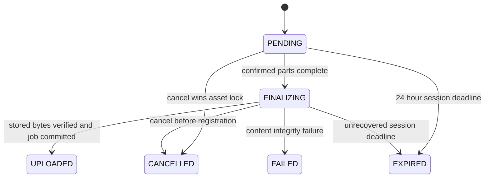

# Media Library integration and engineering review

This is implementation evidence for the approved Media Library slice, not the final independent system-wide acceptance. OpsPilot remains the application. No attendee uploads, interaction attachments, recording, replay publication or livestream insertion were added.

## Baseline and provenance

Destination: `feat/streamops-chat-integration`, architecture checkpoint `3be8621`. Before integration, `928405b` fixed lifecycle correlation/idempotency, `ecbb7d4` fixed prepare-retry revision handling, and `77c5fd9` recorded real regression evidence. The historical streaming acceptance FAIL was preserved, with a separate remediation report. The approved task is `media-library-integration-task.md`.

Mudu source: `7bd9a2f` at `mudu-engineering-showcase`; its pre-existing untracked live-audit materials remain untouched. Independently authored queue/recovery patterns informed this implementation; captured bundles, branding, private research and Mudu schemas/pages/authentication were not copied. The source review and product contracts were committed before implementation in `media-library-integration-plan.md`.

| Capability | Existing OpsPilot retained | Adaptation from independently authored Mudu patterns |
| --- | --- | --- |
| Identity and scope | Staff login, Session, WorkspaceMembership, workspace library, StreamEvent association | Fresh DB authority at media boundaries; owner versus manager actions |
| Persistence | One MediaAsset allocated at initiation, MediaUpload, jobs/attempts/variants | Immutable upload identity/manifest, part receipts, durable finalization and cleanup |
| Storage | Private MinIO and S3 SDK | Native S3 multipart, instead of Mudu's local chunk-file storage |
| Processing | BullMQ, FFmpeg/ffprobe, video/audio profiles, thumbnail, outbox/audit | Durable enqueue recovery, execution generation fencing, orphan reconciliation |
| Frontend | App Router, OpsPilot components, React Query | Page-owned bounded queue, content-based resume, cancellation, stale-callback fencing |
| Integration boundaries | Event attachments, Chat/Topics/Polls, operations SSE, MediaMTX/HLS | Regression only; no new media WebSocket or alternate player framework |

Historical Mudu browser behavior is reference material. Native S3 multipart, the current authorization protocol, processing generations and these recovery contracts are newly designed OpsPilot behavior, not claims about captured production implementation.

## Unified schema and migration

`20261031020000_media_multipart` is additive. Existing single-PUT uploads remain identifiable by `manifest IS NULL`; owner/operation fields are nullable for those historical rows. MediaAsset IDs, event associations and existing job history remain intact.

- **MediaUpload:** ownerUserId, clientOperationId, immutable JSON manifest, private multipartId, finalizingAt, lastGrantExpiresAt, failureReason; FINALIZING/FAILED enum values. `(workspaceId, ownerUserId, clientOperationId)` is unique. Reusing an operation with different content returns409.
- **MediaUploadPart:** `(uploadId, number)` primary key, expected SHA-256, actual size and ETag. Cascading upload relationship, DB bounds on part number1–20/size1–5MiB/SHA format. Service validates exact final-part size and ordered content identity.
- **MediaAsset:** sourceSha256, durable cleanupPending/cleanupAfter/cleanupAttemptedAt. Deletion is a tombstone, not loss of recovery evidence.
- **MediaProcessingJob:** unique nullable uploadId for the initial job, executionVersion for fencing. Explicit processing retry creates a new job; it does not allocate another asset.

The migration probe creates and drops only its own disposable database, applies predecessor migrations, inserts nine representative fixtures, then compares every original column's count/digest. It verified **43 original tables unchanged**, including a legacy upload retaining its original protocol. This is additive migration evidence, not a backup/restore certification.

## Data flow and state ownership




Client queued/hash/upload/pause/finalize/error states are separate from upload lifecycle and asset UPLOADING/PROCESSING/READY/FAILED/DELETED states. 100% transfer does not mean READY. One canonical receipt is used for completion/readback/retry. Asset processing remains polled through existing query conventions; it is not simulated.

The queue reserves each of three slots synchronously before asynchronous hashing. Each worker uploads one part at a time: **at most three active part transfers per page**. Parts are hashed sequentially with bounded buffers; File handles are kept only in the page-owned manager. Confirmed bytes and transient transfer bytes are distinguished; errors/pause reset transient progress to confirmed bytes. Progress callbacks are throttled to100ms, with immediate part/state transitions.

Closing the upload dialog leaves page-owned work running. Navigating away aborts/disposes local transports and references; server sessions remain resumable. Reload lists open sessions first (12 maximum), then terminal receipts up to50. Reselecting verifies size, media profile and every content hash before missing-only transfer. Same-name/same-size different bytes are rejected. No File/Blob, signed URL or credential is persisted in localStorage.

The media view revalidates current identity/membership every5s and remounts its scope on user/workspace/role change. Inflight query and preview requests are aborted; generation checks reject late callbacks. Current authorization is always enforced at the backend, independently of polling latency. Previews stream stored derivatives directly and explicitly pause/remove source/load on teardown. Preview mutation results contain only a receipt/request sequence, with zero idle cache retention; retaining AbortController in cached results was found to retain detached dialogs through AbortError stacks and was removed.

## API, permission and storage contract

Existing `/media-assets` and legacy `/uploads` routes remain. The new `/media-assets/multipart` protocol provides init/list/status, part grant/confirm, complete and cancel. Shared TypeScript contracts live in `packages/media-contracts`; DTO validation remains server-side. UUIDs/object paths/owner/role are derived or checked server-side, never accepted as client authority.

| Principal/action | Policy |
| --- | --- |
| Current staff workspace member | List/read/preview that workspace's assets |
| ADMIN / OPERATIONS_MANAGER / CONTENT_OPERATOR | Initialize/upload, manage ready assets, retry processing and event association |
| Upload owner with current writer permission | Resume, request/confirm parts, complete, cancel |
| ADMIN / OPERATIONS_MANAGER, another owner's upload | May cancel; may not resume/complete it |
| Attendee or unauthenticated client | No workspace media API access |
| Different workspace | Denied; IDs cannot bypass scope |
| Same-workspace multiple events | Legitimate media reuse; each event association remains scoped |
| Referenced or processing asset deletion |409; detach references or wait for processing / cancel unfinished upload |

Protected operations verify Session validity and current WorkspaceMembership in PostgreSQL. Multipart mutations lock the asset, then session/membership through the operation; URL issuance also rechecks authority after waiting for its resource lock. A stale JWT role alone cannot authorize the operation. Existing staff authentication/RBAC outside this media boundary is not replaced.

Defaults:100MiB maximum original,300-second duration,5MiB parts (20max),24h upload session,12 unfinished sessions per owner/64 per workspace. Initialization serializes the quota check on the workspace row. Both frontend and backend enforce supported MP4/MOV/MP3/WAV/M4A profiles; ffprobe verifies actual duration/codecs before READY. Request DTOs reject malformed/oversized manifests. The existing legacy initiation route retains its previous request throttling and compatibility behavior.

Part grants last60s, bound to key, multipart ID, part number, size and expected SHA-256. The server lists authoritative parts, including pagination, and verifies size/hash/ETag before completion. It streams the completed original through ordered part verification plus whole-file SHA-256; a multipart ETag is never treated as a content hash. Keys use server-generated IDs and fixed extensions, not user paths. Upload size/part count and active-session quotas bound pending storage; API download and FFmpeg lifetimes/output are bounded.

Storage is private. Playback/thumbnail URLs default to300s; legacy single-PUT URLs retain their original600s compatibility window. **Already issued URLs are bearer grants**: permission revocation denies fresh URLs and completion, but does not revoke a storage URL already held. Browser transport may finish a valid inflight part; it cannot publish without backend authorization. Cleanup waits for the last upload grant expiry, then aborts multipart sessions and retries deletion. Immediate read revocation requires a protected streaming proxy/CDN authorization boundary, which this phase intentionally does not claim. The retained legacy PUT URL can overwrite its original within its existing TTL; new multipart uploads cannot overwrite a completed object through a part grant.

## Failure and concurrency recovery

PostgreSQL, MinIO and Redis do not share a transaction. Consistency is achieved through durable intent, stable identities, retries and reconciliation, not exactly-once execution.

| Failure boundary | Recovery / verified behavior |
| --- | --- |
| Initialization fails or response is lost | Same immutable operation returns same upload/asset; conflicting manifest409. A reload-restored receipt without a stored multipart ID reconstructs it when requesting its next part under the same lock |
| Part interrupted / confirmation lost | Storage ListParts is authoritative; only missing parts retransmit |
| Object complete, DB write fails / API dies | FINALIZING was committed first; next completion verifies existing original and registers one job |
| Completion response lost | Status/readback returns UPLOADED; no duplicate asset/job |
| Cancellation competes with completion | Asset lock linearizes registration. Cancel wins before registration → tombstone/no job. Registration wins → cancel returns UPLOADED, not fictional cancellation |
| Job committed, enqueue fails | QUEUED intent remains; startup/30s recovery enqueues stable Bull job ID |
| Worker dies / stalled job | BullMQ lock expiry/stall recovery reexecutes. Execution version and current job/asset checks fence stale commits |
| Transcode objects written, DB commit fails | Retry writes attempt-specific keys; one active variant per media/kind/profile and one completion event. Terminal reconciliation removes orphan attempt objects |
| Cleanup storage failure | Tombstone/cleanupPending survives; scheduled retry |
| Storage deletion succeeds, DB commit fails | Repeat deletion is safe; DB cleanup receipt commits on next reconciliation |
| Required stored original/variant missing | Preview URL request fails clearly; reconciliation changes READY→FAILED without deleting metadata |
| Cleanup overlaps renewal/registration | Recheck state under the asset lock; no stale pre-lock decision expires renewed work |

Every derivative write holds the current asset/generation fence until storage settles, and every progress/final/failure commit checks it again. Keys include job ID and execution generation. Deletion cannot finish first and then receive an unfenced late derivative write. Asset deletion is rejected while current processing is active. Expiry rechecks status after acquiring the same lock.

Processing uses the existing two-worker concurrency, three Bull attempts/backoff and FFmpeg profiles. Per-command timeout120s; bounded probe output1MiB and stderr64KiB. Source downloads are bounded to100MiB and60s. The periodic cleanup scans batches of100 with oldest-attempt scheduling, aborts unfinished multipart storage, and removes only objects owned by exact asset prefixes. **Ready shared assets no longer expire merely because24h passed.** Automatic deletion is limited to expired unfinished uploads, cancelled uploads, integrity failures, and explicit deletion. Bucket-wide sweeping was not added.

A SIGKILL can leave an OS temp directory because finally blocks cannot run; operators must inspect and remove only abandoned `opspilot-media-*` / `opspilot-upload-*` directories after confirming no process owns them. Durable storage/DB/queue recovery is automated; safe OS temp janitor policy is a remaining deployment concern. Terminal queue/DB mismatches are surfaced as FAILED with a recovery reason; explicit retry uses the retained source.

## Running and verifying

For the existing integrated development stack, preserve its database and uploads:

```sh
npm ci
npm run db:generate
npm run broadcast:setup
npm run broadcast:dev
```

Open `http://localhost:3000/streamops/media`, sign in with the existing local staff credentials, choose **Upload media**, then inspect processing and private preview. Existing development data is migrated, not reseeded. Do not run `db:seed` or `db:reset` on a shared environment. Ordinary deployments may use their existing environment with `npm run db:deploy` and separately start web/API/worker; broadcast is not required for media upload.

For isolated tests (Docker Desktop running; ports3000/4100 free):

```sh
npm run media:test:setup
node scripts/with-media-test-env.mjs npm run build
npm run test:media:state
npm run test:media:api
npm run test:media:browser
node scripts/with-media-test-env.mjs node scripts/check-media-migration.mjs
```

The tracked wrapper uses `opspilot_media_test` on PostgreSQL5546, Redis6402 and private bucket `opspilot-media-test` on MinIO9002, plus Mailpit1026/8025. Setup only seeds a newly created dedicated DB; rerunning setup does not reseed. Local auth secrets are generated into ignored mode0600 files. The wrapper refuses `NODE_ENV=production`. Real restart tests require the API build first; the npm command includes that step.

Streaming regressions additionally require the existing opt-in MediaMTX instance using the same test secret. Ensure no development publisher is active before switching it:

```sh
node scripts/with-media-test-env.mjs env BROADCAST_ENABLED=true docker compose -p opspilot-broadcast-test -f docker-compose.broadcast.yml up -d
node scripts/with-media-test-env.mjs env BROADCAST_ENABLED=true npm run test:e2e --workspace=@opspilot/api -- --runInBand
node scripts/with-media-test-env.mjs env BROADCAST_ENABLED=true E2E_PRODUCTION_WEB=1 npx playwright test
node scripts/with-media-test-env.mjs env BROADCAST_ENABLED=true npx playwright test --config=playwright.broadcast.config.ts
node scripts/with-media-test-env.mjs env CHAT_RECOVERY_PRODUCTION_WEB=1 npm run test:chat:recovery
```

Run fixed-port suites sequentially. Restore development MediaMTX configuration with `npm run broadcast:setup` before returning to `npm run broadcast:dev`. Keep database, bucket and Redis identifiers together; do not point destructive test fixtures at the development database.

## Test execution and performance evidence

Final verification commands and checkpoints are recorded below. Raw local logs are in `.runtime/media-integration-20261031/`; they are not product source. Initial exploratory and targeted fault runs used the separately created `opspilot_media_integration_20261031_test` DB / `opspilot-media-integration-20261031` bucket / Redis6400. Final reproducible runs use the tracked wrapper above.

Executed backend baseline: **10 suites /89 tests PASS**,234.534s, including actual API/worker SIGKILL and real60s part-URL expiry. An additional concurrency quota case plus strengthened foreign-upload checks passed in a subsequent **6-test boundary suite**,4.655s (five overlap the89-case run). Final review found and fixed missing S3 initialization recovery for reload-restored receipts; the complete multipart suite then passed **11/11**,70.094s, including the new fault case and real URL expiry. These are91 distinct current API cases exercised across the full and targeted runs, not a claim that a single91-case full run was executed. Backend unit suite: **16 suites /106 tests PASS**,4.541s. Chat/Topics/media state tests: **19 PASS**,922.5ms. Original-column migration preservation PASS.

The full browser run executed27cases:26passed, with one obsolete upload-dialog wording/control assertion failing. It was updated to assert the new100MiB/5-minute/pause contract and form **Close** behavior, including confirming the dialog is removed. No backend/data assertion was weakened. Real Broadcast/Watch Room browser regression passed4/4 (2.1min); staff/attendee Chat fault recovery passed12/12 (1.4min). Its targeted rerun passed1/1 in23.5s (test2.2s). The five real-media browser workflows passed in that full run, including original hash, missing-only resume, wrong-content rejection, lost completion, revocation,3-worker scheduling, cancellation, actual playback and10-cycle resource cleanup.

Production-built API, worker and Web images all built. Two Web dependency installation attempts failed withECONNRESET; installing only the Web workspace/root build dependencies removed unnecessary API/FFmpeg packages from that image build and succeeded. Real container startup then passed API health, worker readiness, Web login page, multipart bytes, Linux FFmpeg output, source hash and private preview after an API container restart. This used isolated local configuration, not a hosted TLS deployment.

Official npm production dependency audit: **0 advisories**. Including development tools: **40 advisories (36moderate,4low;0high/critical)**. Major-version/downgrade suggestions for existing lint/test tools were not automatically applied. See `media-library-evidence/dependency-summary.json`.

The successful resource-fix run measured:

| Observation | Measured value |
| --- | --- |
| Upload including browser hashing/finalization |9.947s |
| Time until READY |12.893s |
| Actual part-transfer window / throughput |4.894s /20.43MiB/s |
| Persisted worker processing duration |2.636s |
| API RSS sampled49times |252.52–291.08MiB |
| Browser JS heap during upload |7.52–11.48MiB |
| Animation-frame gap p95 / max in this run |16.7 /16.8ms |
| Progress DOM mutations |20; about2.01/s across upload duration |
| After each of10preview cycles |704DOM nodes /381listeners, stable;0retained old video nodes after GC |

The original probe retained10video nodes and grew27listeners/210nodes per preview cycle. Heap analysis traced it to a React Query mutation result retaining a controller, its abort exception stack and a PointerEvent's detached dialog. The corrected test now explicitly fails if more than one old video node survives collection. Post-warmup JS heap still rose by roughly0.27MiB over the short10-cycle run; native memory and long-session behavior are not certified. Performance was observed locally while other build activity could compete for resources, so it is not an isolated throughput benchmark. Raw measurements: `media-library-evidence/local-performance.json`.

Performance uses a generated H.264 MP4 with free-atom padding to104,856,576bytes,20parts and one active file; separate controlled tests verify three concurrent files and fourth-file waiting. Browser CDP heap excludes native decoder/Blob memory; API RSS excludes worker/FFmpeg/MinIO; progress DOM mutations are not React render counts. Five/ten preview cycles are a bounded regression observation, not proof of unlimited leak freedom or production-scale capacity.

Host: macOS x86_64,64GiB RAM, Node22.20.0, Chrome156.0.8078.74. Docker: Linux x86_64,16vCPU/~7.75GiB RAM; PostgreSQL17, Redis7.4.10, pinned MinIO RELEASE.2025-09-07T16-13-09Z, Mailpit1.31.0 and MediaMTX1.21.3. Generated media fixtures contain no third-party footage.

Failed attempts are retained: initial Docker-unavailable startup; an expiry fixture that violated an existing DB check (fixture corrected); a cancellation test selector that included another scenario's retained upload (selector scoped to this run, DB assertions retained); a legacy regression assertion for intentionally replaced dialog wording/control (updated to the new contract with an added close assertion); and a real cached-preview retention problem identified by heap-retainer analysis and corrected. No assertions were removed to hide production failures.

## Decisions, alternatives and remaining limits

- Native S3 multipart avoids a second storage service/chunk reassembly implementation. It requires a backend full-original read/hash pass for strong integrity; this adds local IO and a bounded finalization transaction. A separate verifier/outbox state machine is a future option if measured latency requires it.
- Current-role checks and row locks reuse existing identity. Short bearer grants keep bytes off the API; immediate revocation would cost a protected delivery path. The stated TTL window is deliberate.
- Durable tombstones make cross-system deletion retryable. Referenced/processing deletion409 keeps this phase simple; force-delete with job cancellation is excluded.
- Local queue ownership avoids a global store and prevents hidden background work after route change. Reload requires original-file reselection; drafts/files are not persisted across refresh.
- Existing full library listing remains unpaginated and local-only performance is not a large-library certification. Upload-session restoration itself is bounded and prioritizes all open work.
- Resume has a24h deadline; terminal receipts/metadata are retained, not an unlimited history-retention guarantee. Failed processing retains source for explicit retry.
- Container/process availability, worker restart and tested faults are local evidence. Multi-region storage, multi-node failover, prolonged outages, malware scanning and arbitrary codec support were not added. Existing production environment validation and deployment gates still apply.
- The page detects permission changes within its5s context refresh; backend enforcement is immediate at protected operations. Existing downloads already authorized retain their bounded access window.

## Interview discussion prompts

1. Why is S3 ETag insufficient to identify multipart source bytes? Explain per-part SHA, completion verification and retransmission.
2. Where do completion/cancellation linearize when S3 and PostgreSQL cannot commit together?
3. Why reserve upload slots before async hashing, and how do file versus part concurrency differ?
4. How does generation fencing protect progress, storage writes and final DB commits after worker restart?
5. What can a revoked user do with an already issued signed URL, and how would immediate revocation change architecture?
6. Why can an aborted controller retained in a query cache keep detached UI nodes alive? How was that distinguished from merely stopping playback?
7. How do durable job intent and BullMQ job identity recover enqueue loss without claiming exactly-once side effects?
8. What migration checks prove backward compatibility, and which operational guarantees do they not prove?


## Verification commands and checkpoints

`W` below expands to `node scripts/with-media-test-env.mjs`; `D` expands to
`node .runtime/media-integration-20261031/env.mjs` (the preserved exploratory
wrapper using the dated isolated resources). These prefixes never select the
ordinary development DB. Commands were run from the OpsPilot repository root.

| Actual command | Result / evidence |
| --- | --- |
| `D node scripts/check-media-migration.mjs` | PASS43original tables /9fixtures; legacy upload preserved |
| `npm run test -- --runInBand` |16suites /106passed |
| `node --import tsx --test tests/chat-state.test.ts tests/topics-state.test.ts tests/topics-drafts.test.ts tests/media-queue.test.ts` |19passed |
| `W env BROADCAST_ENABLED=true npm run test:e2e --workspace=@opspilot/api -- --runInBand` |10suites /89passed;234.534s |
| `D env BROADCAST_ENABLED=false npm run test:e2e --workspace=@opspilot/api -- --runInBand media-boundaries.e2e-spec` |6passed, including newly added concurrent quota;4.655s |
| `D env BROADCAST_ENABLED=false npm run test:e2e --workspace=@opspilot/api -- --runInBand media-multipart.e2e-spec` |11passed after initialization recovery fix;70.094s |
| `W env BROADCAST_ENABLED=true E2E_PRODUCTION_WEB=1 npx playwright test --trace=off --output=.runtime/media-integration-20261031/browser-regression` |26passed /1old-dialog-contract assertion failed;8.0min |
| `W env BROADCAST_ENABLED=true E2E_PRODUCTION_WEB=1 npx playwright test e2e/launch-control.spec.ts --grep 'v1.1 reliability' --trace=off --output=.runtime/media-integration-20261031/browser-contract-rerun` |1passed after updating the asserted intentional UI contract;23.5s |
| `W env BROADCAST_ENABLED=true npx playwright test --config=playwright.broadcast.config.ts --output=.runtime/media-integration-20261031/broadcast-browser` |4passed;2.1min |
| `W env CHAT_RECOVERY_PRODUCTION_WEB=1 npm run test:chat:recovery -- --trace=off --output=.runtime/media-integration-20261031/chat-recovery` |12passed;1.4min |
| `npm run containers:build` |API/worker built; Web dependency installECONNRESET. One unchanged Web retry also failed; scoped Web dependency build succeeded |
| `docker build -f apps/web/Dockerfile -t opspilot-web:local .` |PASS after workspace-scoped dependency installation |
| `docker build --target api -f apps/api/Dockerfile -t opspilot-api:local .` and corresponding `--target worker` |PASS, rebuilt after initialization fix |
| `D env BROADCAST_ENABLED=false node scripts/check-media-containers.mjs` |PASS again against final images: real multipart, LinuxFFmpeg, stored-source SHA,2variants, restarted API persistence/preview |
| `npm audit --omit=dev --registry=https://registry.npmjs.org --json` |PASS0production advisories |
| `npm audit --registry=https://registry.npmjs.org --json` |Exit1:40development-toolchain advisories,0high/critical; documented debt |

Regression separation: Chat messaging/history/moderation/scroll/burst and12fault
cases passed. Topics moderation/private visibility/pinning/replies/keyset/identity
switches/429recovery passed. Polls and Live Operations/SSE, staff auth, attendee
registration and revocation, workspace/event controls, readiness, analytics,
webhooks/audit and existing real media preview passed. Broadcast tests exercised
real RTMP publishing and protected HLS, viewer recovery, autoplay fallback,
revocation and API restart. Mocked UI evidence is listed separately from these
real backend workflows.

Implementation checkpoints:

- `3be8621`: plan/contracts before implementation.
- `ba91276`: additive schema, multipart/storage/backend, recovery and integration tests.
- `bda68de`: queue/UI/preview cleanup, browser tests and reproducible environment.
- `8632e12`: recover missing S3 initialization on resumed receipts.

Final build/lint/type, isolated-UI result and development restoration are recorded
in the closing verification section below. Source Mudu remains at7bd9a2f with
its original two untracked live-audit paths unchanged.


## Closing verification and handoff — 2026-11-01

- `W npm run test:ui:isolated -- --trace=off --output=.runtime/media-integration-20261031/isolated-ui`: **12/12 PASS**,23.5s. This uses mocked API UI scenarios for Polls/admission; it is supplementary to the real workflows above.
- `W npm run build`: **PASS**, NestJS and Next.js production builds on final implementation. `npm run typecheck` and `npm run lint`: **PASS** after final fixes. Formatting-only lint failures in the new quota test were corrected using the repository ESLint formatter; no checks were disabled.
- Final API/worker/Web images and the container runtime probe: **PASS**. No production deployment was performed.
- Original development was paused during fixed-port test suites. A read-only snapshot and post-migration comparison verified **43existing tables /174rows** unchanged across all original columns (migration metadata excluded). `npm run broadcast:setup` applied only `20261031010000_media_event_correlation` and `20261031020000_media_multipart`; it did not seed/reset the DB.
- The normal `node scripts/with-broadcast-env.mjs --development npm run dev` supervisor was restored. Web3000, API4100, worker, original PostgreSQL`opspilot_chat_test`, Redis6381 and its existing private bucket are active. Verified API readiness, login/logout, current media authority,3existing assets, resumable upload list, event list, broadcast enabled and authenticated MediaMTX control200 with no active publishers. Test-only probe containers were removed; isolated databases/buckets/evidence are retained.
- Final report/evidence is in this document and `media-library-evidence/`. `evidence-index.json` records local log digests without copying secrets or heap contents. No source Mudu files were changed.

The Media Library integration is complete within the declared local scope, with
no known unresolved P0/P1 defect identified in that scope. Remaining operational
limits (URL revocation windows, OS temp cleanup after SIGKILL, local-only
measurements, unpaginated asset listing and development-toolchain advisories)
remain explicit. This statement does not replace an independent acceptance
review. Stop here: final system-wide acceptance and further features require a
separate task.
