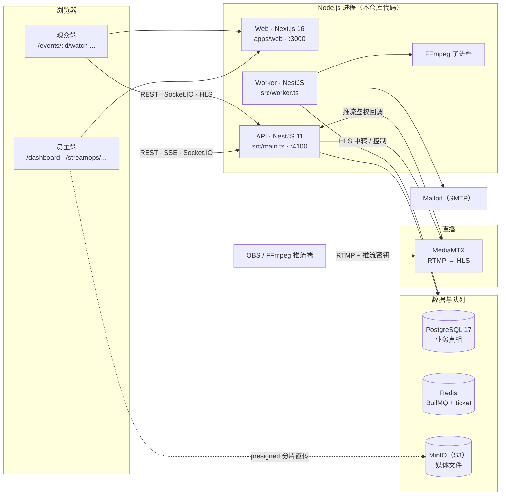
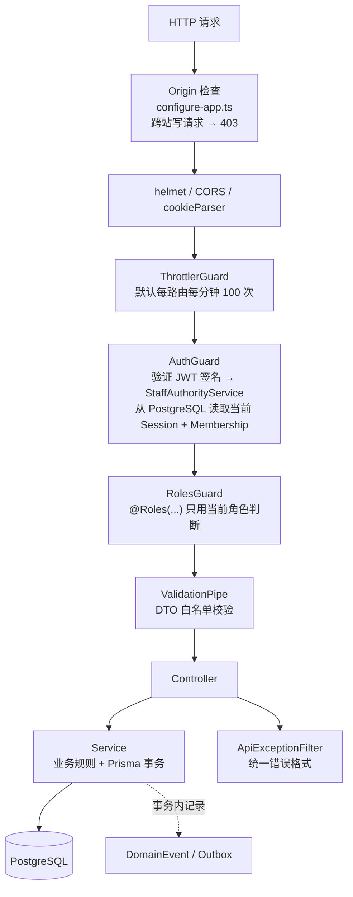
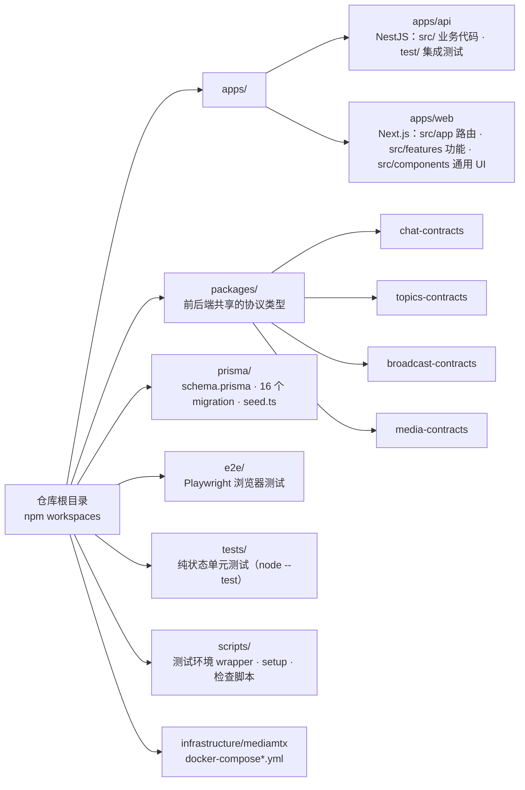
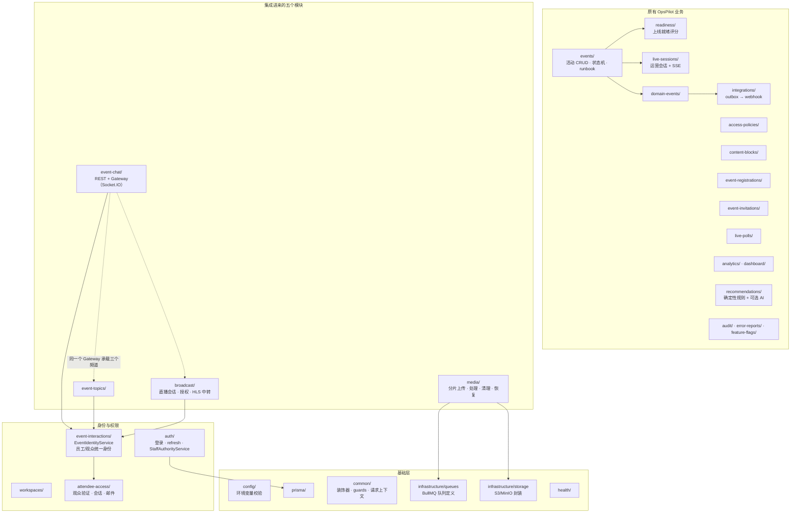
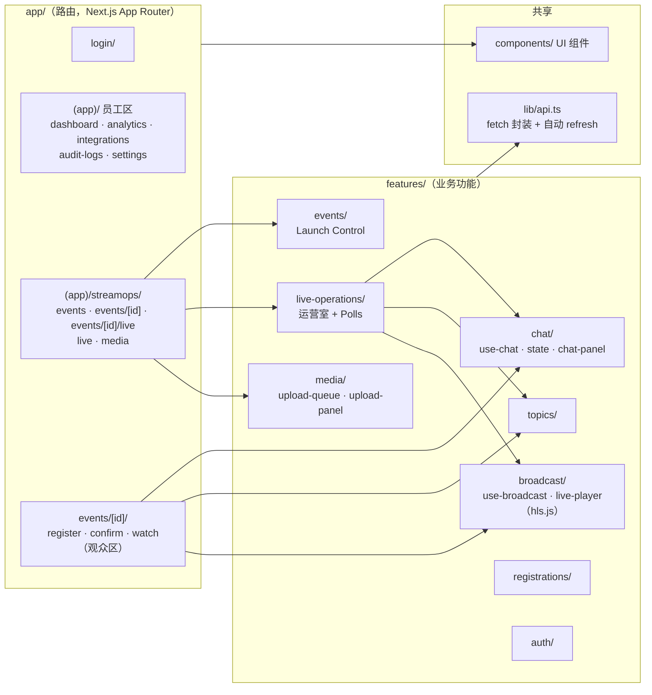
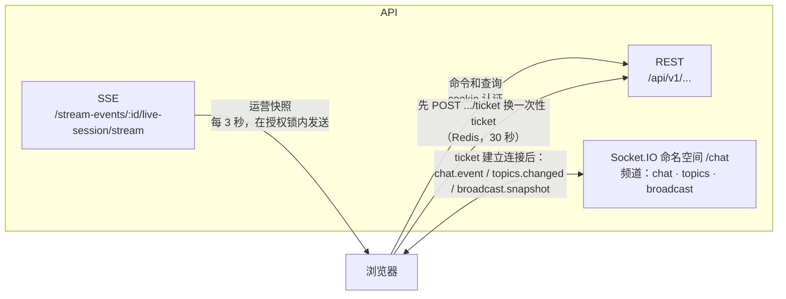
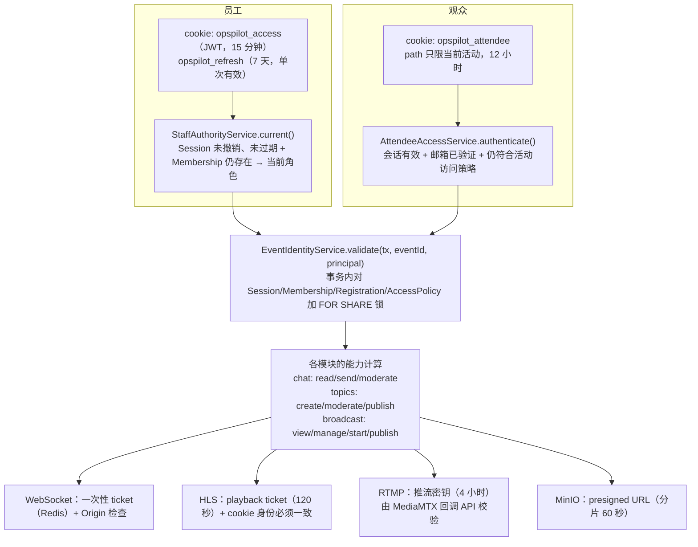
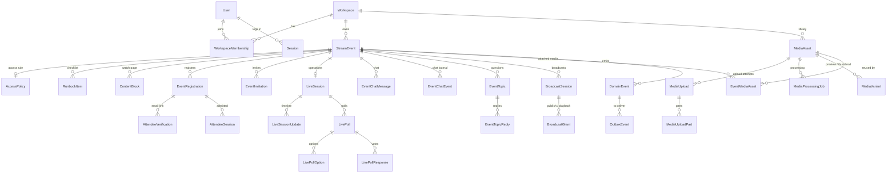
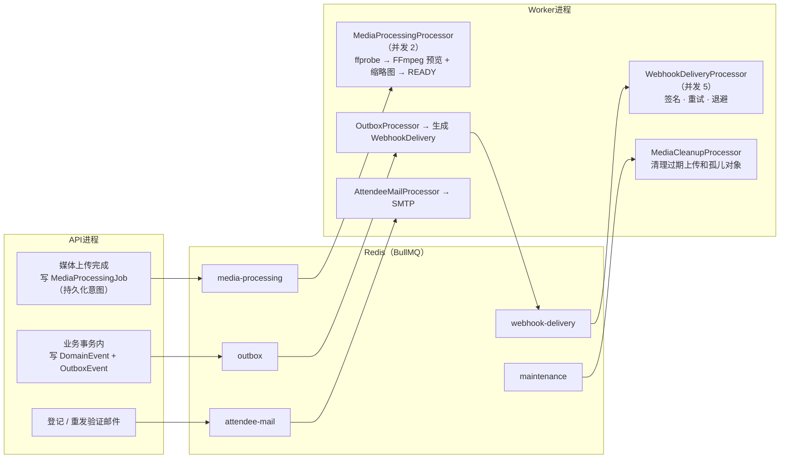

# 01 · 项目架构

本章回答三个问题：项目由哪些进程组成、代码放在哪里、各层之间怎样通信和做权限判断。所有图都根据当前 `main` 的代码绘制。看到“代码位置”时，建议打开对应文件对照阅读。

> 阅读建议：先看 1.1 和 1.2，建立“有哪些东西在运行”的整体印象，再看 1.3–1.5 了解代码组织，最后看 1.6–1.9 的通信方式和权限。

---

## 1.1 运行时全景：有哪些进程

几个要点：

- **API 和 Worker 是同一份 NestJS 代码的两个入口。** `main.ts` 启动 HTTP 服务；`worker.ts` 只启动队列消费者（媒体处理、outbox、webhook、邮件、清理）。耗时的事情交给 Worker 去做，API 的请求不会被拖慢。
- **浏览器直接访问 API**（`NEXT_PUBLIC_API_URL`）。Next.js 负责页面渲染，不代理业务请求。
- **大文件不经过 API。** 浏览器拿到 presigned URL 后，直接把分片上传到 MinIO；API 只负责签发 URL 和记账。
- **视频流要经过 API。** 观众请求的 HLS playlist 和分片都由 API 鉴权后，再从 MediaMTX 转发，所以 MediaMTX 不对外开放。

## 1.2 一个请求经过哪些层

- 标记了 `@Public()` 的路由（登录、观众端接口、健康检查、MediaMTX 回调）会跳过 AuthGuard。观众端接口改由 `EventIdentityService` 自己校验观众会话（见 1.7）。
- **JWT 只证明“你是谁”。** 当前角色每次请求都从数据库读取，所以降权、移除成员、登出都会立刻生效。

## 1.3 Monorepo 目录地图

`packages/*-contracts` 存放前后端共用的 TypeScript 类型，例如 Chat 消息、Topic 快照、直播快照，用来保证两端对同一份数据的理解一致。

## 1.4 后端模块地图（apps/api/src）

- **原有业务**沿用经典的 Controller → Service → Prisma 结构，由全局 guard 负责员工权限。
- **集成进来的模块**（Chat、Topics、Broadcast，以及媒体的部分接口）需要同时服务员工和观众，所以统一通过 `EventIdentityService.validate()`，在**数据库事务内加行锁**后再校验身份和权限。这样即使权限在操作进行中被撤销，也不会让旧权限完成写入或推送。

## 1.5 前端结构（apps/web/src）

运营室（`events/[id]/live`）和观众的观看页（`events/[id]/watch`）复用同一套 Chat、Topics、Broadcast 组件，通过 `mode: "staff" | "attendee"` 区分身份。

## 1.6 浏览器和服务器之间的三种通信方式

| 方式 | 用在哪里 | 为什么选它 |
| --- | --- | --- |
| REST | 所有命令（发送、审核、开始直播……）和首次加载 | 简单、可重试，幂等性由 `clientOperationId` 保证 |
| SSE | Live Operations 运营快照 | 单向推送，原有功能就是这样设计的 |
| Socket.IO | Chat、Topics、直播状态通知 | 双向通信；Chat 发送用 ack；同一个连接通道复用三个频道 |

**一个重要的设计：** WebSocket 推送的大多只是“有变化”的通知。客户端收到后，会用 REST 拉取一份经过授权验证的快照。过期或乱序的推送因此不会覆盖新数据，也不会把已删除的内容恢复回来。教程第 5、6 课会详细讲这一点。

## 1.7 身份与权限的四道关口

**员工角色**（`WorkspaceRole`）：`ADMIN`、`OPERATIONS_MANAGER` 可以管理；`CONTENT_OPERATOR` 可以推流和管理媒体；`ANALYST`、`VIEWER` 只读。观众永远不会获得 workspace 权限。

## 1.8 数据模型（核心实体）

需要先记住的三个区分：

1. **`LiveSession` 和 `BroadcastSession` 是两回事。** 前者是“活动正在运营”（时间线、Polls），后者是“视频正在推流”。结束直播不会结束运营。
2. **`MediaAsset` 属于 workspace，不属于某个活动。** 通过 `EventMediaAsset` 挂到多个活动上复用。
3. **员工（`User`）和观众（`EventRegistration`）是两套身份。** Chat 和 Topics 的作者字段只能二选一，由数据库的 CHECK 约束保证。

完整的 44 个模型见 `prisma/schema.prisma`。

## 1.9 后台任务（Worker）

**设计原则：** “要做什么”先写进 PostgreSQL（持久化意图），再放进队列。即使 Redis 丢了任务、Worker 中途崩溃，恢复服务（`media-queue-recovery.service.ts`）和 outbox 调度器也能根据数据库中的记录把任务补回来。这就是 ADR-0004 中的“事务性 outbox”。

## 1.10 本地端口一览

| 服务 | 开发环境 | 测试环境（默认，可用 `OPSPILOT_TEST_*` 覆盖） |
| --- | --- | --- |
| Web / API | 3000 / 4100 | 3000 / 4100 |
| PostgreSQL | 5544 | 5546 |
| Redis | 6379 | 6381（chat）· 6394（broadcast）· 6402（media） |
| MinIO API / 控制台 | 9000 / 9001 | 9002 / 9003 |
| Mailpit SMTP / UI | 1025 / 8025 | 1026 / 8025 |
| MediaMTX RTMP / HLS / 控制 | 1937 / 8890 / 9999（可选） | 同左 |
