# 02 · 业务流程

本章按“一场线上活动从准备到复盘”的顺序，画出每个关键业务流程。每张图下面列出它对应的代码入口，方便你对照阅读或在课上逐行讲解。

---

## 2.1 端到端产品旅程

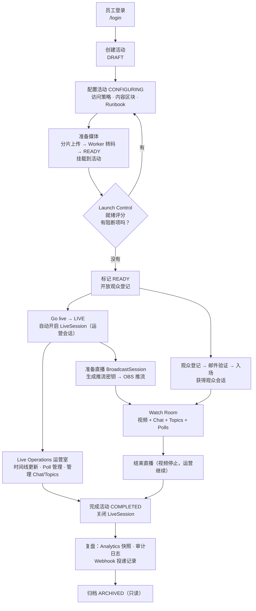

## 2.2 活动状态机

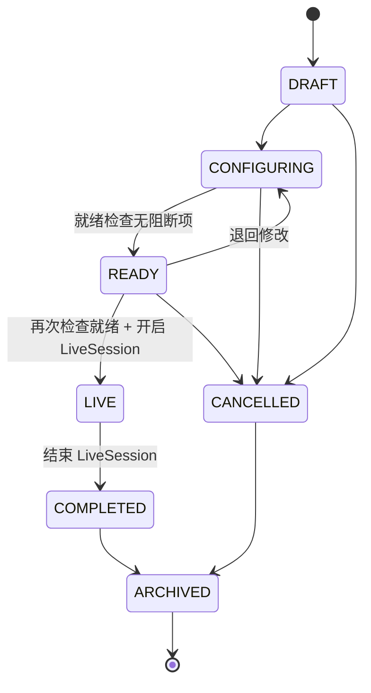

- 代码：`apps/api/src/events/events.service.ts` 的 `transitionMap` 和 `transition()`。
- 进入 READY 和 LIVE 前，都会调用 `ReadinessService.calculate()`。有 blocker 就返回 400，并附上阻断原因。
- 每次状态变化都会在**同一个事务**里写入 `DomainEvent`（例如 `event.ready`、`event.live`），后续触发 webhook（见 2.10）。
- **观众只能在 READY 和 LIVE 状态下登记和入场**（`attendee-eligibility.ts` 中的 `attendeeStates`）。

## 2.3 Launch Control 就绪评分

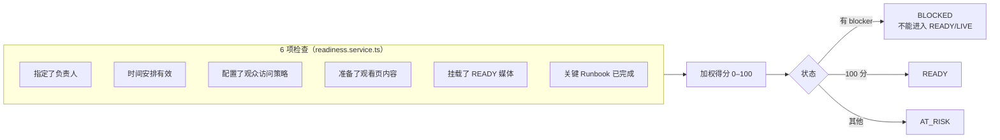

评分是**确定性规则**（ADR-0002），可选的 AI 建议只是辅助，不参与判断（ADR-0005，`recommendations/`）。

## 2.4 观众登记与入场

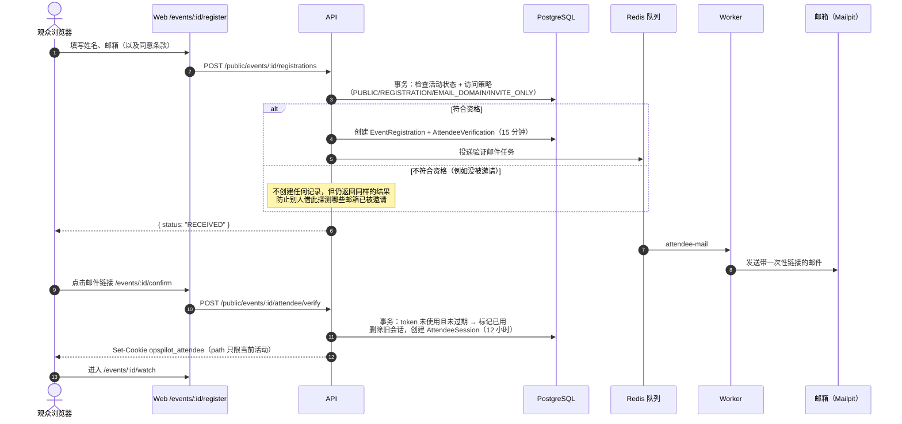

- 代码：`event-registrations.service.ts` 的 `register()`、`attendee-access.service.ts` 的 `enqueue/verify/authenticate()`、`attendee-eligibility.ts`。
- **入场不等于成为 workspace 成员。** 观众 cookie 只对 `/api/v1/public/events/:id` 这一个活动有效。
- 在 INVITE_ONLY 模式下撤销邀请，或者活动离开 READY/LIVE，观众随后的每次请求都会被拒绝，因为每次都会重新检查资格。

## 2.5 员工登录、续期与当前权限

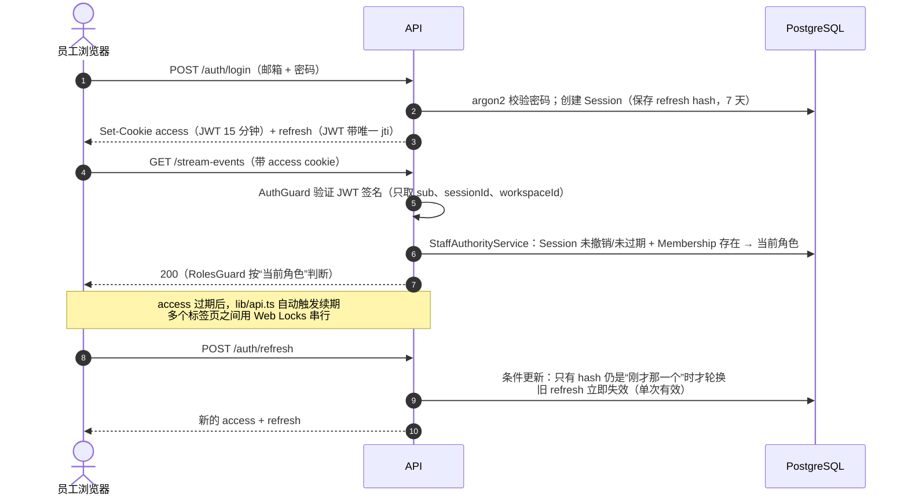

这一流程对应审计修复的 SYS-AUTH-01/03。可以对比 `git show d260eab`、`git show aed3495` 看修复前后的差异，它们是很好的安全案例。

## 2.6 Chat：发送、推送与断线恢复

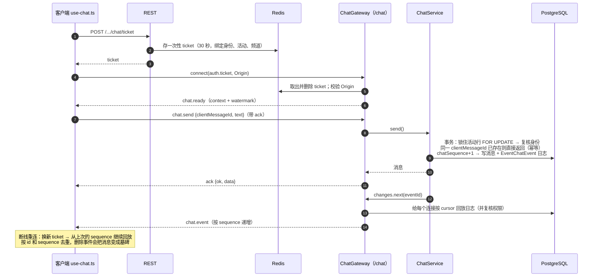

- 前端状态：`features/chat/state.ts`（纯函数，可单独测试）+ `use-chat.ts`（连接管理）。
- **为什么要有日志表（journal）：** 只发“最新列表”的话，丢包、重连或乱序时客户端无法知道自己漏了什么；有了按 sequence 递增的事件日志，就能精确补齐。

## 2.7 Topics / Q&A：提问、审核、置顶

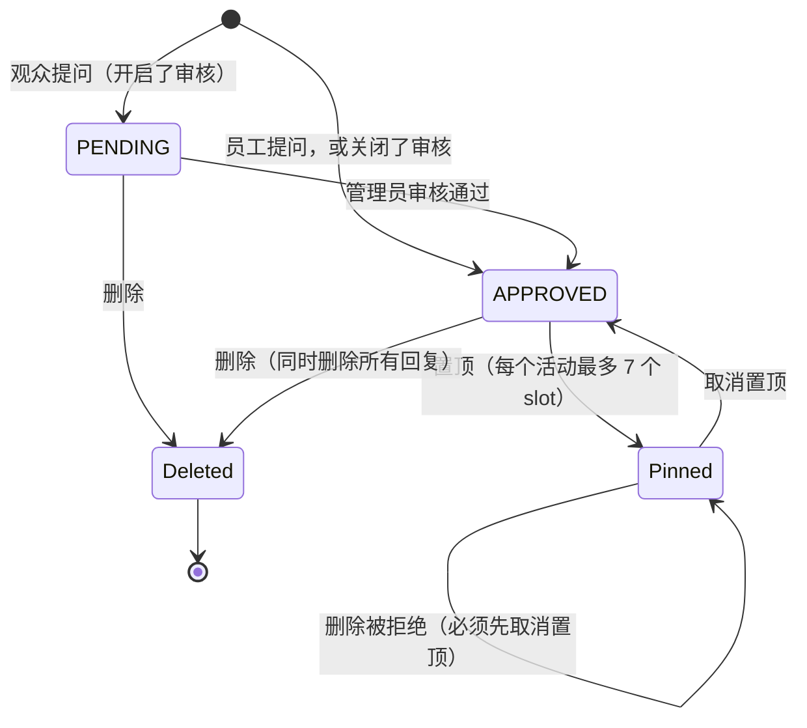

规则以及在哪里保证（**不只靠前端**）：

| 规则 | 保证方式 |
| --- | --- |
| 只有 APPROVED 能置顶 | `topics.service.ts` 的 `moderate()` + 数据库 CHECK `EventTopic_pin_check` |
| 每个活动最多 7 个置顶 | `pinSlot` 取值 1..7 + 唯一索引 `(eventId, pinSlot)` + 活动行 `FOR UPDATE` 串行化 |
| 两个管理员同时操作只有一个成功 | `expectedVersion` 乐观并发：版本号对不上 → 409 |
| 置顶中不能删除 | 服务端检查，返回 409 |
| 回复不会挂到已删除的问题上 | 同一把锁 + 父级 `deletedAt` 检查，返回 404 |
| 观众提问、回复的开关 | `topicSettings` 由后端执行，直接调 API 绕不过去 |

## 2.8 媒体：分片上传与处理

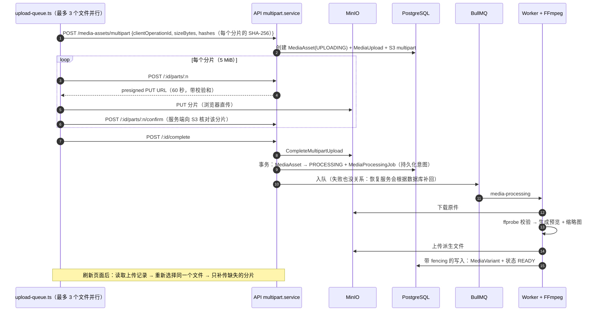

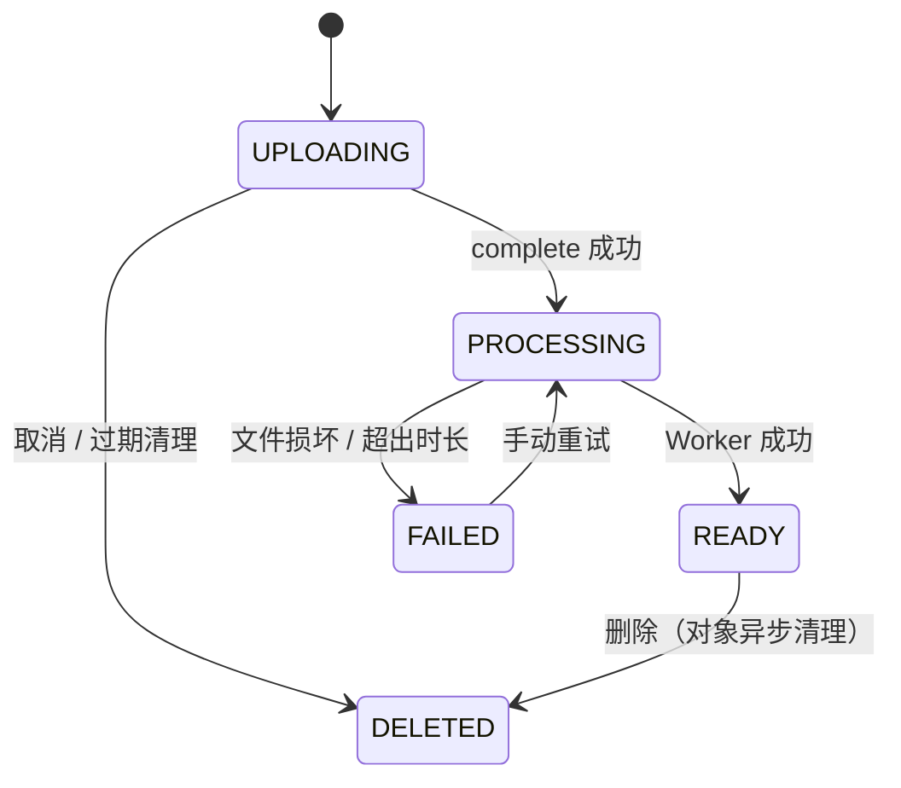

- 每条 complete 和 cancel 请求都带 `clientOperationId`。响应丢了也可以安全重试，不会产生两个资产。
- **跨系统一致性不靠“分布式事务”：** PostgreSQL 记录“应该发生什么”，MinIO 和 BullMQ 的结果通过幂等键、状态条件和定期恢复（`media-queue-recovery.service.ts`、`media-cleanup.processor.ts`）达到最终一致。
- 代码里还保留着一套旧的单次 PUT 上传接口（`POST /media-assets/uploads`），只为兼容旧客户端，Web 端已经不再使用。

## 2.9 直播：准备 → 推流 → 观看 → 结束

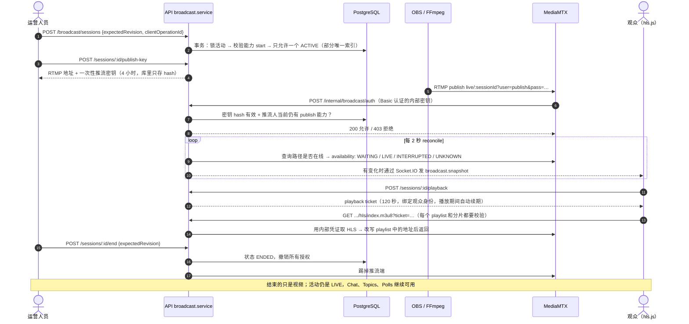

**三种状态要分清**（审计 G2 的要求）：

1. **活动的运营状态**（`StreamEvent.status`）：由运营人员推进。
2. **直播的推流状态**（`BroadcastSession.availability`）：由 reconcile 循环观察 MediaMTX 得到。
3. **某个观众的播放状态**（暂停、静音、全屏）：只存在于这个观众的浏览器里，不影响其他人。

## 2.10 运营室、Polls 与事件通知

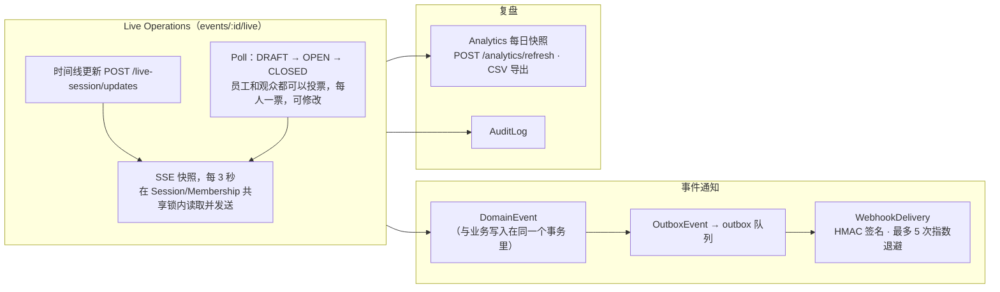

- 撤权后，SSE 会发送 `access-changed` 事件并关闭；客户端清空私有数据（SYS-AUTH-02）。
- 如果只是 SSE 连接断了，客户端保留数据并按退避间隔重连（CA-LIVEOPS-01）。这两种情况的处理方式不同，是很好的对照学习材料。
