# 05 · 从零搭建 OpsPilot（主线课程）

这是学习手册的**主线**。你会在一个全新的空仓库里，一步一步把 OpsPilot 从零写出来：业务代码、数据库、Docker、CI/CD、测试、部署都自己动手写。当前的 OpsPilot 仓库只当作**参考答案**，用来在每课结束后对照。

- 01、02 章的架构图和业务流程图是“地图”，每课开始前先看对应的图。
- 03 章是“读代码”的课程表，现在用作每课的**参考阅读**。
- 04 章记录了参考答案自身的代码质量整理。

## 5.1 怎么上课

每一课按同样的五步走：

1. **讲清目标**：这一课结束时系统能多做什么、要新建哪些文件，先看图。
2. **一行一行写**：我每次给一小段代码（通常不超过 20 行），逐行解释；你**自己敲进去**，不要整段复制。敲错了正好是学习机会。
3. **跑起来、写测试**：每课都有验收命令。测试不通过就一起排查，不跳过。
4. **提交和合并**：在分支上提交，开 PR，等 CI 变绿后合并。从第 6 课起，每一课都要经过 CI。
5. **对照参考答案**：合并之后再去看 OpsPilot 里对应的文件，记下差别和原因，写到 `notes/lesson-XX.md`。

三条规则：

- **先写简单版，再加固**。比如 Chat 先做“能收发消息”，再一步步加上幂等、回放、断线恢复。每一次加固都由一个先失败的测试引出来。
- **课程中不看参考答案的代码**，做完再看。卡住时问我，不要去翻答案。
- **每课一个可运行的提交**。任何时候 `main` 都能跑起来、测试都是绿的。

## 5.2 新仓库

| 项目 | 约定 |
| --- | --- |
| 本地目录 | `~/computer_science/projects/opspilot-lab` |
| GitHub 仓库 | `zhanru-dev/opspilot-lab`（你自己在网页上新建，空仓库，不勾选 README） |
| 技术栈版本 | 与参考答案一致：Node 22、npm workspaces、NestJS 11、Prisma 6、PostgreSQL 17、Redis、Next.js 16、React 19、Tailwind 4、React Query 5、BullMQ、Socket.IO |
| 端口（避免和 OpsPilot 开发环境冲突） | Web **3200** · API **4200** · Postgres **5442** · Redis **6390** · MinIO **9100/9101** · Mailpit **1035/8035** |
| Docker Compose 项目名 | `opspilot-lab` |

你的电脑已经具备：Node 22.20、npm 10.9、Git 2.46、Docker 29 + Compose v5、FFmpeg 9、Homebrew、VS Code。还缺 GitHub CLI（`gh`），可以用 `brew install gh` 装上，用来在命令行开 PR，不装也可以在网页上操作。

## 5.3 路线图

```mermaid
flowchart LR
  M0["M0 准备<br/>第 0 课"] --> M1["M1 能跑的骨架<br/>第 1–6 课"]
  M1 --> M2["M2 员工登录与权限<br/>第 7–10 课"]
  M2 --> M3["M3 活动与发布准备<br/>第 11–15 课"]
  M3 --> M4["M4 容器化与交付<br/>第 16–18 课"]
  M4 --> M5["M5 后台任务与集成<br/>第 19–21 课"]
  M5 --> M6["M6 观众入场<br/>第 22–25 课"]
  M6 --> M7["M7 实时互动<br/>第 26–33 课"]
  M7 --> M8["M8 媒体<br/>第 34–37 课"]
  M8 --> M9["M9 直播<br/>第 38–40 课"]
  M9 --> M10["M10 收尾与作品集<br/>第 41–43 课"]
```



每个里程碑结束时，系统都是一个**能演示的产品**：M3 结束时你已经有一个能登录、能规划活动、带 CI 的全栈应用；M4 结束时它能用 Docker 镜像一键启动，CI 会自动构建并发布镜像。后面的里程碑在这个基础上加功能。

一课约等于一次 1.5–2 小时的学习。全部 44 课，按每周 3 课算大约 15 周。

---

## M0 · 准备

### 第 0 课 · 仓库与工作流
- **目标**：新建仓库，学会这门课每天都要用的 Git 流程。
- **你会做**：`git init`、`.gitignore`、`.editorconfig`、`README.md`、`.nvmrc`（写 `22`）；关联 GitHub 远程仓库；建分支 → 提交 → 推送 → 开 PR → 合并。
- **概念**：工作区、暂存区、提交、分支、远程、PR；为什么 `main` 只通过 PR 修改。
- **验收**：GitHub 上 `main` 有第一个提交；你能独立完成一次“分支 → PR → 合并”。

---

## M1 · 能跑起来的骨架

结束时：`docker compose up` 启动数据库，`npm run dev` 启动 API 和 Web，网页显示“API operational”；每个 PR 自动跑 CI。

### 第 1 课 · Monorepo 与代码规范
- **你会写**：根 `package.json`（workspaces：`apps/*`、`packages/*`）、`tsconfig.base.json`、Prettier 配置、ESLint 配置（包括 `one-var: never` 和 `no-nested-ternary`）。
- **概念**：npm workspaces 怎样共享依赖；TypeScript 的 `strict`；为什么格式和规则要用工具强制。
- **验收**：`npm run lint` 和 `npm run format:check` 通过。
- **参考**：根 `package.json`、`apps/api/eslint.config.mjs`、`apps/web/eslint.config.mjs`。

### 第 2 课 · NestJS API 骨架
- **你会写**：`apps/api` 的 `main.ts`、`app.module.ts`、全局前缀 `/api/v1`、`HealthModule`（`GET /health/live`）、环境变量校验（缺配置就启动失败）。
- **概念**：模块、控制器、服务、依赖注入；fail fast；Jest 单元测试。
- **验收**：`curl localhost:4200/api/v1/health/live` 返回 `{"status":"ok"}`；`npm test` 通过。
- **参考**：`apps/api/src/main.ts`、`configure-app.ts`、`config/environment.ts`、`health/`。

### 第 3 课 · Docker Compose：PostgreSQL 与 Redis
- **你会写**：`docker-compose.yml`（postgres:17、redis，带健康检查、数据卷、端口由环境变量决定）、`.env.example`；`GET /health/ready` 检查数据库和 Redis。
- **概念**：镜像、容器、数据卷、网络、健康检查；为什么开发环境的依赖要放进容器；“存活”和“就绪”的区别。
- **验收**：`docker compose up -d --wait` 后 `/health/ready` 返回正常；停掉 Redis 后返回 503。
- **参考**：`docker-compose.yml`、`health/health.service.ts`。

### 第 4 课 · Prisma 与第一批数据表
- **你会写**：`prisma/schema.prisma`（`Workspace`、`User`、`WorkspaceMembership`）、第一次迁移、`seed.ts`、`PrismaService`。
- **概念**：数据模型、关系、唯一约束、迁移文件为什么要提交、种子数据只用于开发库。
- **验收**：`npm run db:migrate`、`npm run db:seed` 成功；用 Prisma Studio 看到数据。
- **参考**：`prisma/schema.prisma` 前四个模型、`prisma/seed.ts`、`apps/api/src/prisma/`。

### 第 5 课 · 真实数据库上的 API 测试 + Next.js 骨架
- **你会写**：API e2e 测试（supertest，连接独立的 `opspilot_lab_test` 数据库，拒绝在非 `_test` 库上运行）；`apps/web` 的 Next.js App Router 骨架、Tailwind、`lib/api.ts`、React Query，首页显示 API 状态。
- **概念**：测试数据库隔离；客户端组件与服务端组件；React Query 的查询与缓存。
- **验收**：`npm run test:e2e` 通过；打开 `localhost:3200` 看到“API operational”。
- **参考**：`apps/api/test/app.e2e-spec.ts`、`scripts/test-env.mjs`、`apps/web/src/lib/api.ts`、`components/layout/app-shell.tsx`。

### 第 6 课 · CI：GitHub Actions
- **你会写**：`.github/workflows/ci.yml`：安装 → lint → typecheck → 单元测试 → 构建 → 用 Postgres/Redis 服务容器跑 e2e；在 GitHub 上打开分支保护（必须 CI 通过才能合并）。
- **概念**：workflow、job、step、服务容器、缓存；为什么“红了就不能合并”。
- **验收**：故意提交一个 lint 错误，CI 变红；修好后变绿再合并。
- **参考**：`.github/workflows/ci.yml` 的 `quality` 任务。

---

## M2 · 员工登录与权限

结束时：员工能登录、退出，不同角色看到和能做的事情不同，权限被撤销后立刻生效。

### 第 7 课 · 密码与登录
- **你会写**：argon2 密码哈希；`POST /auth/login`；`Session` 表；15 分钟的 access JWT 放在 httpOnly cookie 里。
- **概念**：为什么不存明文密码；cookie 的 `httpOnly`、`secure`、`sameSite`；登录失败时不泄露“用户是否存在”。
- **参考**：`auth/auth.service.ts`、`auth/auth.controller.ts`。

### 第 8 课 · Refresh token 轮换
- **你会写**：7 天的 refresh token（带 `jti`，数据库只存哈希）、`POST /auth/refresh`、`POST /auth/logout`；用一条带条件的 `updateMany`（比较并交换）保证每个 refresh token 只能被消费一次，并发刷新也一样。
- **概念**：token 轮换、比较并交换；测试先写：“同一个 refresh token 用两次，第二次必须失败”。进阶（参考答案没做）：发现旧 token 被重放时吊销整个会话。
- **参考**：`auth/auth.service.ts`、`apps/api/test/app.e2e-spec.ts` 中的认证用例。

### 第 9 课 · 守卫、角色与当前权限
- **你会写**：`AuthGuard`、`@Roles()` 装饰器、`StaffAuthorityService`（每个请求重新读取 Session 和 Membership）、审计日志 `AuditService`（和业务写入在同一个事务里）。
- **概念**：认证和授权的区别；为什么不能只信 JWT 里的角色；事务。
- **验收**：e2e 角色矩阵测试；把用户降级后，旧 token 的下一个请求立即被拒绝。
- **参考**：`auth/auth.guard.ts`、`auth/staff-authority.service.ts`、`audit/`、`test/current-authority.e2e-spec.ts`。

### 第 10 课 · Web 登录与受保护页面
- **你会写**：登录页、`AuthProvider`、`(app)` 布局与导航；`apiFetch` 遇到 401 先 refresh 再重试，多个标签页用 Web Locks 串行刷新；第一个 Playwright 测试（登录 → 看到首页）。
- **概念**：路由分组；全局认证状态；浏览器端到端测试。
- **参考**：`app/login/page.tsx`、`features/auth/auth-provider.tsx`、`lib/api.ts`、`app/(app)/layout.tsx`。

---

## M3 · 活动与发布准备

结束时：员工能创建活动、填写 runbook 和访问策略，看到就绪评分，满足条件后把活动推进到 READY / LIVE。

### 第 11 课 · 活动 CRUD
- **你会写**：`StreamEvent` 模型；创建、列表（搜索、状态筛选、分页）、详情、修改；DTO 校验；时区处理。
- **参考**：`events/events.service.ts`、`events/dto/`、`app/(app)/streamops/events/page.tsx`。

### 第 12 课 · 状态机
- **你会写**：状态流转表（DRAFT → CONFIGURING → READY → LIVE → COMPLETED → ARCHIVED）、非法流转返回 409、每次流转写审计和领域事件。
- **概念**：状态机；用测试列举所有合法和非法流转。
- **参考**：`events/events.service.ts` 的 `transitionMap`、[02 §2.2](02-business-flows.md)。

### 第 13 课 · 就绪评分
- **你会写**：`RunbookItem`、`AccessPolicy`、`ContentBlock` 模型和接口；`ReadinessService`（纯函数计算分数和硬性阻断项，单元测试覆盖每条规则）；READY/LIVE 流转前检查阻断项。
- **概念**：把业务规则写成纯函数；证据（evidence）让结果可解释。
- **参考**：`readiness/readiness.service.ts` 与它的 spec、[02 §2.3](02-business-flows.md)。

### 第 14 课 · Launch Control 页面
- **你会写**：容器组件 + 面板组件 + `useLaunchControlActions` + `QueryState`；变更成功后让相关查询失效；对话框表单。
- **概念**：容器组件与展示组件；React Query 的 mutation 与 invalidation。
- **验收**：Playwright：完成 runbook → 配置访问策略 → 分数变化 → Mark ready。
- **参考**：`features/events/launch-control/`、`e2e/launch-control.spec.ts`。

### 第 15 课 · 推荐与仪表盘
- **你会写**：确定性推荐规则（纯函数）、解决推荐、仪表盘统计。
- **参考**：`recommendations/recommendations.service.ts`、`dashboard/`、`app/(app)/dashboard/page.tsx`。

---

## M4 · 容器化与交付（CI/CD）

结束时：整套系统能用生产镜像一键启动；`main` 每次合并后 CI 自动构建、冒烟测试并发布镜像到 GHCR。

### 第 16 课 · Dockerfile
- **你会写**：API、Worker、Web 的多阶段 Dockerfile（依赖层缓存、`prisma generate`、Next.js standalone 输出、非 root 用户）、`.dockerignore`。
- **概念**：镜像分层与缓存；构建镜像和运行镜像分离；镜像体积和安全。
- **参考**：`apps/api/Dockerfile`、`apps/web/Dockerfile`、`.dockerignore`。

### 第 17 课 · 生产形态的 Compose 与冒烟测试
- **你会写**：生产 compose 配置（迁移作为一次性任务先运行、健康检查、依赖顺序、环境变量与密钥）；一个冒烟测试（Playwright 登录并打开一个活动）。
- **概念**：配置与代码分离；启动顺序；“能构建”不等于“能运行”。
- **参考**：`playwright.deployment.config.ts`、`e2e/deployment.smoke.spec.ts`、`.github/workflows/deployment-smoke.yml`。

### 第 18 课 · 持续交付
- **你会写**：CI 的 `containers` 任务：构建三个镜像 → 启动 → 冒烟测试 → 在 `main` 上用 commit SHA 打标签推送到 GHCR；依赖安全检查（`npm audit`）。
- **概念**：CI 与 CD 的区别；不可变镜像标签；供应链安全（还记得 MinIO 镜像从 Docker Hub 下架的事吗）。
- **参考**：`.github/workflows/ci.yml` 的 `containers` 任务。

---

## M5 · 后台任务与集成

### 第 19 课 · Worker 进程与 BullMQ
- **你会写**：独立的 worker 入口、BullMQ 队列、重试与退避；API 和 Worker 共享代码但分开部署。
- **参考**：`apps/api/src/worker.ts`、`worker.module.ts`。

### 第 20 课 · 事务性 outbox
- **你会写**：业务写入和 `OutboxEvent` 在同一个事务里；调度器把 outbox 投递到队列；处理器幂等。
- **概念**：为什么不能“先写库再发消息”；至少一次投递 + 幂等 = 效果上恰好一次。
- **参考**：`domain-events/`、`integrations/outbox-scheduler.service.ts`、`outbox.processor.ts`。

### 第 21 课 · Webhook 投递与 Integration Centre
- **你会写**：Webhook endpoint 与订阅、HMAC 签名、最多 5 次的指数退避重试、投递记录、手动重试；Integrations 页面。
- **参考**：`integrations/`、`app/(app)/integrations/page.tsx`、`features/integrations/`。

---

## M6 · 观众入场

### 第 22 课 · 公开活动页与登记
- **你会写**：三种访问策略（PUBLIC / EMAIL_DOMAIN / INVITE_ONLY）、公开活动页、登记接口（不符合资格也返回同样的结果，防止用户枚举）。
- **参考**：`event-registrations/`、`features/registrations/public-registration.tsx`。

### 第 23 课 · 邮件验证与观众会话
- **你会写**：Mailpit 加入 compose；一次性、15 分钟有效、只存哈希的验证 token；邮件发送走 outbox；观众会话 cookie（按路径隔离）。
- **参考**：`attendee-access/`、`features/registrations/confirm-attendee.tsx`。

### 第 24 课 · 邀请
- **你会写**：邀请、撤销、每次请求重新判断资格。
- **参考**：`event-invitations/`、`attendee-access/attendee-eligibility.ts`。

### 第 25 课 · 统一身份 EventIdentityService
- **你会写**：员工和观众的联合身份类型；在事务里对活动行加 `FOR SHARE` 锁后再校验权限。
- **概念**：行锁；为什么锁要持有到“写入或推送完成”。
- **参考**：`event-interactions/event-identity.service.ts`、[01 §1.4](01-architecture.md)。

---

## M7 · 实时互动

这一部分最难，也最能体现工程能力。每个功能都先写一个只能“正常情况下工作”的版本，再用测试逐个制造故障（断线、重复发送、乱序、撤权），一步步加固。

### 第 26 课 · SSE 运营室
- **你会写**：`LiveSession` 与更新、SSE 推送、撤权时通知客户端；前端区分“没权限了”和“只是断线”，断线指数退避重连。
- **参考**：`live-sessions/`、`features/live-operations/live-session-room.tsx`。

### 第 27 课 · Chat 后端 v1
- **你会写**：一次性连接 ticket、Socket.IO 网关、发送并广播消息。
- **参考**：`event-chat/chat-ticket.service.ts`、`chat.gateway.ts`。

### 第 28 课 · Chat 后端 v2：日志、幂等与回放
- **你会写**：按活动递增的 sequence 与事件日志、`clientMessageId` 幂等、按 cursor 回放、删除用墓碑。先写失败的测试：重复发送产生两条消息、断线期间的消息丢失。
- **参考**：`event-chat/chat.service.ts`、`test/chat.e2e-spec.ts`。

### 第 29 课 · Chat 前端
- **你会写**：先写简单 hook；再把状态逻辑抽成纯函数 reducer 并写单元测试；加上重连、回放、去重、滚动锚点。
- **参考**：`features/chat/state.ts`、`use-chat.ts`、`chat-panel.tsx`、`tests/chat-state.test.ts`、`e2e/chat-recovery.spec.ts`。

### 第 30 课 · Topics 后端
- **你会写**：提问、回复、审核、置顶（最多 7 个，用数据库约束保证）、`expectedVersion` 乐观并发。
- **参考**：`event-topics/topics.service.ts`、`test/topics.e2e-spec.ts`。

### 第 31 课 · Topics 前端
- **你会写**：列表与筛选、提问/回复表单、失败重试复用同一个操作 ID、编辑草稿遇到远端修改时保留草稿。
- **参考**：`features/topics/`。

### 第 32 课 · Polls
- **参考**：`live-polls/`、`features/live-operations/live-polls-panel.tsx`、`features/registrations/attendee-live-polls.tsx`。

### 第 33 课 · 重构课：提取共享连接器
- **你会做**：发现 Chat、Topics 的 hook 里重复的“ticket → 连接 → 就绪 → 收到通知后重新同步 → 退避 → 拒绝”流程，把它提取成不依赖 React 的 `EventChannelConnection`，用假 socket 写单元测试。所有已有测试必须保持通过。
- **对照**：参考答案里这一步**没有做**，这是你超过参考答案的地方（见 [04 §4.3](04-code-quality.md) R4）。

---

## M8 · 媒体

### 第 34 课 · 对象存储与 presigned URL
- **你会写**：MinIO 加入 compose、S3 SDK、私有 bucket、短时效的签名下载地址。
- **参考**：`infrastructure/storage/storage.service.ts`。

### 第 35 课 · 分片上传
- **你会写**：5 MiB 分片、每片单独签名 URL、浏览器上传队列（并发、暂停、续传）。
- **参考**：`media/multipart.service.ts`、`features/media/upload-queue.ts`、`tests/media-queue.test.ts`。

### 第 36 课 · 转码 Worker
- **你会写**：ffprobe 探测、FFmpeg 转码、生成缩略图和派生文件；重试；进程崩溃后靠持久化的“处理意图”恢复。
- **参考**：`media/media-processing.processor.ts`、`media/command-runner.ts`、`test/media-restart.e2e-spec.ts`。

### 第 37 课 · Media Library 页面
- **参考**：`app/(app)/streamops/media/page.tsx`、`features/media/library/`。

---

## M9 · 直播

### 第 38 课 · MediaMTX 与推流鉴权
- **你会写**：MediaMTX 加入 compose；RTMP 推流、HLS 播放；推流鉴权回调验证短时效的推流凭证。
- **参考**：`infrastructure/mediamtx/mediamtx.yml`、`broadcast/media-relay.service.ts`。

### 第 39 课 · 直播会话与 reconcile
- **你会写**：开始直播的幂等、修订号检查、每 2 秒对账一次的 reconcile 循环、可用性状态（WAITING / LIVE / INTERRUPTED / UNKNOWN）。
- **参考**：`broadcast/broadcast.service.ts`、`broadcast/media-utils.ts`、`test/broadcast.e2e-spec.ts`。

### 第 40 课 · 播放器与观看页
- **你会写**：hls.js 播放器、120 秒的播放凭证续期、观众观看页把视频、Chat、Topics、Polls 组合在一起；CI 加上直播测试任务。
- **参考**：`features/broadcast/`、`.github/workflows/ci.yml` 的 `broadcast` 任务。

---

## M10 · 收尾与作品集

### 第 41 课 · 完整业务流程测试与无障碍
- **你会写**：Playwright 端到端旅程（员工准备 → 观众登记 → 观看 → 互动）、axe 无障碍检查、测试端口与数据库隔离脚本。
- **参考**：`e2e/`、`scripts/test-env.mjs`。

### 第 42 课 · 安全加固
- **你会做**：写一份威胁模型；限流、安全响应头、CORS、密钥管理、依赖审计；用测试证明每一项防护有效。
- **参考**：`docs/threat-model.md`。

### 第 43 课 · 作品集发布
- **你会做**：README（架构图、本地运行、测试、设计取舍）、演示数据、案例页面、打 `v1.0.0` 标签并发布镜像。
- **参考**：根 `README.md`、`app/case-study/page.tsx`。

---

## 5.4 每课的笔记模板

在新仓库的 `notes/lesson-XX.md` 里记录：

```md
# 第 XX 课 · 标题
## 今天做了什么
## 新学的概念（用自己的话写）
## 踩过的坑
## 和参考答案的差别，以及原因
## 还没想明白的问题
```
